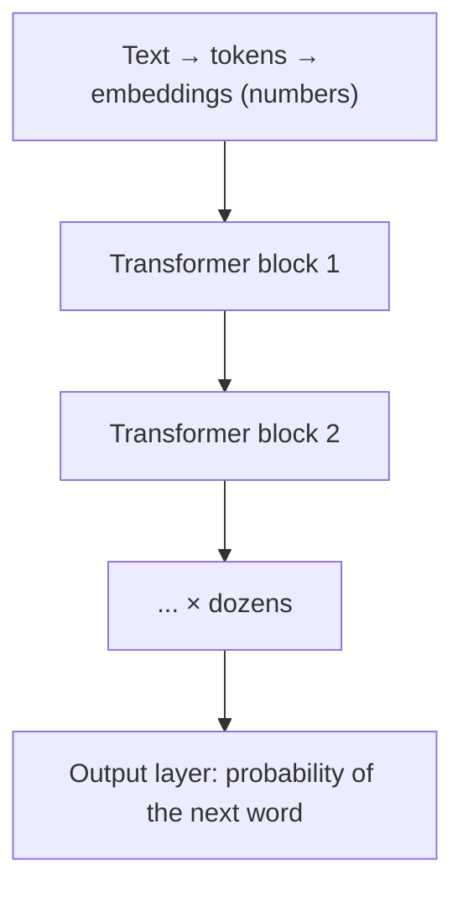
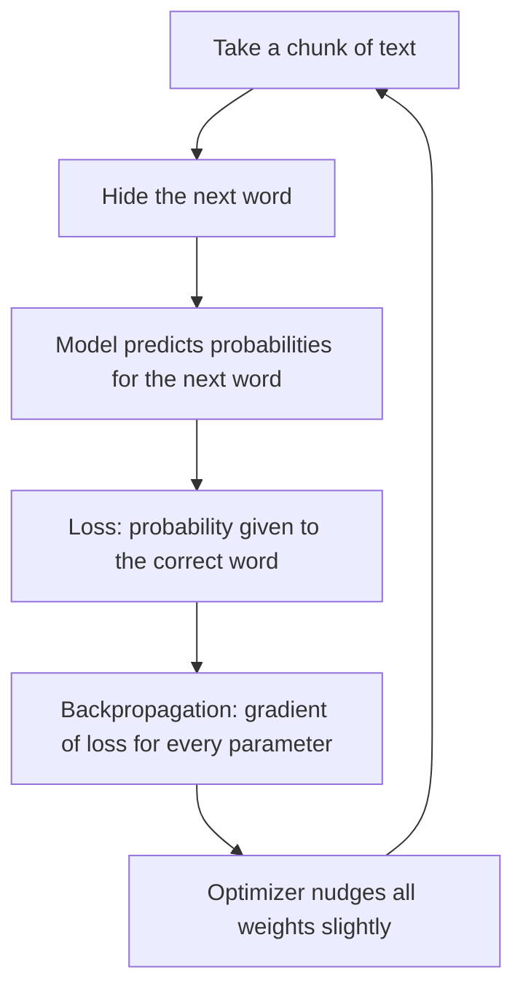

[Artificial Neural Networks](../index.md) → Notes → From ANN to LLMs

---

# From ANN to LLMs: Parameters, Layers, Activations and Training

## Key Concepts

### An LLM is a very large neural network
- Same building blocks as the ANN course: weights, layers, activation functions, and training by nudging weights to reduce error.
- Differences: enormous scale, and layers arranged as **Transformer blocks** (with attention) rather than plain dense layers.
- Real-world link: phone keyboard autocomplete predicts your next word. An LLM does the same with billions of weights and far more context.

---

### Parameters and layers
- A **parameter** is one learnable number: a weight or a bias.
- "70B parameters" means 70 billion such numbers across all layers.
- Parameters live in each layer's weight matrices:
    - One layer mapping 4,096 → 4,096 inputs holds 4,096 × 4,096 ≈ 16.8 million weights.
    - Stack ~80 layers, each with several matrices → tens of billions.
- More layers and wider layers → more capacity to store patterns.

### Transformer block

- **Attention**: each word looks at the other words and decides which matter (e.g. "bank" attends to "river"). Built from learned weight matrices (Q, K, V). The new ingredient compared with the ANN course.
- **Feed-forward network (FFN)**: the Week 4 MLP: weights → activation → weights. Holds roughly two-thirds of the parameters.

---

### Activation functions in LLMs

| Function | Used in | Idea |
|---|---|---|
| ReLU | Original Transformer (2017) | Pass positives, zero out negatives |
| **GELU** | GPT-2/3, BERT | Smooth ReLU; lets small negatives through gently |
| **SwiGLU** | LLaMA, PaLM, many modern models | Gated: one path decides how much of another path passes |

- Smooth functions replaced ReLU because ReLU's hard zero kills gradients (dying ReLU), which hurts very deep networks.
- **Softmax** is used inside attention and at the output layer to turn scores into probabilities that sum to 1.

---

### How parameters are tuned (training)

- **Task**: next-token prediction. The text supplies its own answers, so no human labels are needed.
- **Loss**: cross-entropy, which punishes giving the correct word low probability.
- **Backpropagation**: the chain rule from Week 2, applied through every layer.
- **Optimizer**: Adam/AdamW, which adapts the step size per parameter.
- **Numerical stability** (Week 2, Lesson 4) matters at scale: learning-rate warm-up, gradient clipping, LayerNorm/RMSNorm, bf16 precision.
- **Scale**: trillions of tokens, thousands of GPUs, weeks to months.

### Training stages
1. **Pre-training**: next-word prediction on huge text. Sets almost all parameters; learns language and facts.
2. **Fine-tuning**: example conversations, so it behaves like an assistant.
3. **RLHF / preference tuning**: humans rank answers; the model is nudged toward preferred ones.

Stages 2 and 3 use the same nudging mechanism with different data and loss.
