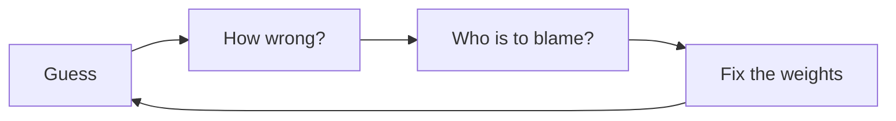
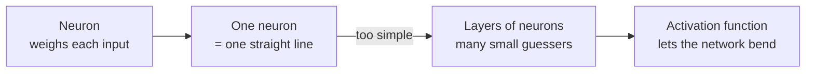
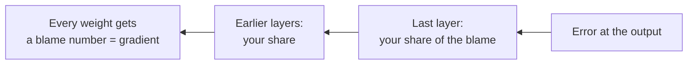
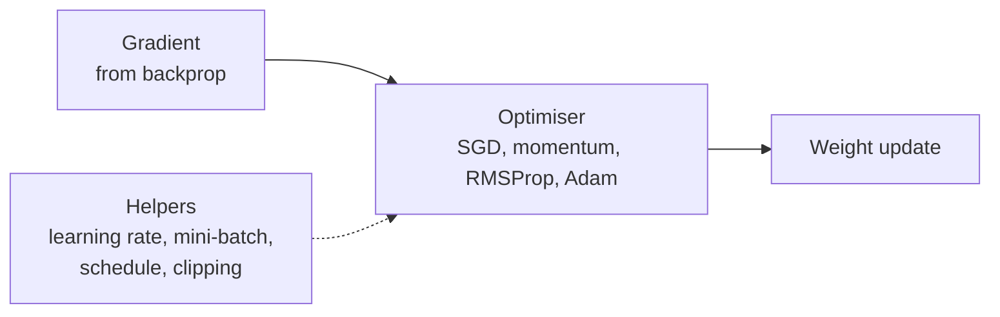

[Artificial Neural Networks](../index.md) → Notes → The Simple Story

---

# The Simple Story

## Key Concepts

### The whole course in one loop
Training a neural network is one loop, repeated millions of times.

- The running example: **teaching a robot to guess house prices** from size, rooms and location.

---

### 1. Build the guesser

- A **neuron** takes numbers (size, rooms, location) and decides how much each one matters. Those importance values are the **weights**. The **bias** is a baseline nudge added on top (it shifts the line).
- Inside the neuron: multiply each input by its weight, add them up (a **dot product**), add the bias, then pass the result through an activation.
- The **perceptron** is the simplest neuron: weighted sum, then a yes/no **step** decision. It draws one **straight line**, so it only works when the data is **linearly separable**. It fails on **XOR**.
- The **logistic neuron** is the same, but uses the **sigmoid** to output a smooth probability between 0 and 1, which makes it learnable with gradients.
- **Layers** of neurons pass their answers on to the next layer. Together they form a **multilayer perceptron (MLP)**, also called a **feed-forward network**: **input layer** (the raw numbers), **hidden layers** (the middle guessers), **output layer** (the final answer).
- Sending data through the layers to get a prediction is the **forward pass**.
- An **activation function** sits between layers. Without it, many layers would still collapse into one straight line. The common ones:
    - **ReLU**: `max(0, z)`. Cheap, and the usual choice for hidden layers.
    - **Sigmoid**: squashes to 0-1. Used for yes/no probabilities.
    - **Tanh**: squashes to -1 to 1.
    - **Softmax**: turns scores into probabilities that add up to 1. Used for choosing among categories.

---

### 2. Measure how wrong it is
- The first guesses are bad, because the weights start random.
- The **loss** is one number for "how wrong". Lower is better.
- Common losses: **MSE** for predicting numbers (prices), **cross-entropy** for choosing categories.

---

### 3. Find who to blame

- **Backpropagation** works backwards from the error and tells every weight "you pushed the answer too high, so go down a bit".
- A **derivative** is the slope: how much the output changes if one input moves a little. The **gradient** is the slopes of all the weights together, the blame number telling you which way is downhill.
- The **chain rule** makes backprop possible: to get a weight's blame, multiply the slopes of each step between that weight and the error.
- A **computational graph** is the calculation drawn as boxes and arrows. The forward pass goes along the arrows, backprop goes back along them.
- Two things can go wrong: the blame fades to nothing (**vanishing gradient**) or blows up (**exploding gradient**).
- Good **starting weights** (Xavier / He initialisation) and ReLU help prevent both.

---

### 4. Fix the weights smartly
An **optimiser** is the rule that turns each weight's gradient into a weight update. **Helpers** make any optimiser work better or more safely.

#### The optimisers
- **Gradient descent**: step downhill by `slope × step size`. The basic one. It comes in three flavours, depending on how much data you use per step:
    - **Batch**: all the data. Accurate but slow.
    - **SGD** (stochastic): one example. Fast but erratic.
    - **Mini-batch**: a small group, about 32. The default.
- **SGD + momentum**: keep rolling in the same direction, so the **zig-zag** across narrow valleys cancels out.
- **RMSProp**: shrink the step for weights whose gradients are big, grow it for weights whose gradients are small.
- **Adam**: momentum + RMSProp, so each weight gets its own direction and step size. It uses **bias correction** to fix its slow start. Use it as your default. A popular recipe is Adam first, then SGD + momentum to fine-tune.

#### Terrain words
- **Loss landscape**: the hilly field of loss values you are walking over.
- **Local / global minimum**: a valley bottom / the lowest valley of all.
- **Saddle point**: flat but not a valley, like a horse saddle. You can get stuck there.
- **Plateau**: a very flat stretch where progress crawls.
- **Sharp vs flat minimum**: flat valleys tend to work better on new data.
- **Noisy vs smooth convergence**: mini-batches make the loss curve wobble. That is normal, so watch the overall trend.
- **Epoch**: one full pass over all the training data.

#### The helpers
- **Learning rate**: the step size every optimiser uses. Too small is slow, too big overshoots.
- **Batch size**: how many examples per step. Small is noisy but explores well, large is smooth but may settle in sharp minima. 32-256 is typical.
- **Schedules**: big steps early, small steps late. The common types:
    - **Step decay**: keep the step size fixed, then drop it sharply at set points (0.1 → 0.01 → 0.001).
    - **Exponential decay**: shrink it by a fixed factor every epoch, so it falls smoothly.
    - **Cosine annealing**: start high and fall along a smooth curve to nearly zero at the end.
    - **Warm-up**: start very small and rise for the first few steps, then decay. Important for transformers.
- **Gradient clipping**: stops one huge step from wrecking training. By **value** it caps each number, by **norm** it scales the whole gradient down and keeps its direction (more common).

---

### Glossary
| Word | Plain meaning |
|---|---|
| Weight | How much an input matters |
| Layer | A group of neurons that pass answers forward together |
| Activation | The bend between layers |
| Loss | One number for "how wrong" |
| Gradient | The slope; which way is downhill |
| Backpropagation | Working backwards to give every weight its gradient |
| Learning rate | How big each step is |
| Optimiser | The rule for taking the step (SGD, momentum, Adam) |
| Bias | A baseline nudge added to the weighted sum |
| Forward pass | Sending data through the layers to get a prediction |
| Derivative | The slope for one input |
| Chain rule | Multiply the slopes along the path to get a weight's blame |
| Initialisation | How the weights are set before training (Xavier, He) |
| Epoch | One full pass over the training data |
| Minimum / saddle / plateau | Valley bottom / flat but not a valley / very flat stretch |
