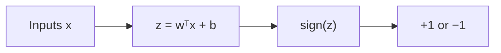
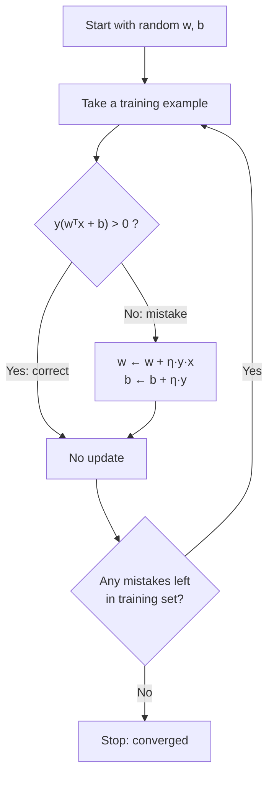
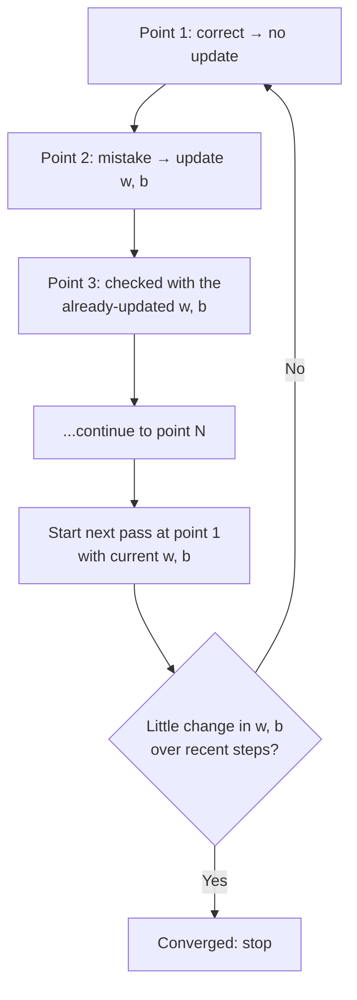

[Artificial Neural Networks](../../index.md) → <span class="week-crumb">Week 3: Perceptron and Logistic Neuron</span> → Lesson 2: The Perceptron

---

# The Perceptron

## Key Concepts

### 1. Perceptron as a Simple Linear Classifier

#### Definition
- The simplest computational model of a neuron and the first true neural network model
  (Frank Rosenblatt, late 1950s). Purpose: **binary classification**.
- Computation:
    - `z = wᵀx + b` — weighted sum of inputs plus bias
    - `ŷ = sign(z)` — `+1` if `z > 0`, `−1` if `z < 0`



#### Linear classifier
- `wᵀx + b = 0` is a **line** in 2-D, a **plane** in 3-D, a **hyperplane** beyond that.
- It splits the input space into two **half-spaces**: one side is `+1`, the other `−1`.
- A single perceptron is exactly **one** line (or one plane / hyperplane) — never more.
- ★ So it can only classify **linearly separable** data — where one straight line or
  hyperplane separates the classes. If not (e.g. one class ringed by the other), no
  choice of weights and bias works.

---

### 2. Geometric Interpretation in 2D

#### The decision boundary
- In 2-D: `w₁x₁ + w₂x₂ + b = 0`, a straight line in the `x₁x₂` plane.
- Classification is a **sign test** — which side of the line the point is on. No
  distance, probability or confidence yet.
- Via the dot product: `wᵀx` measures alignment between input and weight vector;
  positive and large enough → `+1`.

#### Many boundaries can work
- If the classes are well separated, **infinitely many** lines separate them; there is no
  single "correct" one. Training just converges on one of them.
- Real data is never this clean: points sit near the boundary and classes overlap, so
  the goal becomes the best **accuracy** (e.g. 2 wrong out of 8 points → 6/8 = 75%),
  not a perfect split.

#### Dot product intuition
- `wᵀx` is the projection of one vector on the other (`|x|·cos θ`): it measures
  **alignment**.
- Small angle θ → vectors point the same way → large **positive** value (`+1`).
  Large angle (opposite directions) → **negative** value (`−1`).
- `wᵀ` is used instead of `w` only so dimensions line up: `w` is 2×1, `wᵀ` is 1×2,
  and 1×2 times 2×1 works (inner dimensions match).

#### Roles of weights and bias
| | Weights `w` | Bias `b` |
|---|---|---|
| Controls | **Orientation** of the boundary | **Position** of the boundary |
| Change it | Boundary **rotates** | Boundary **shifts parallel** to itself |

- `w` is the **normal vector** (perpendicular) to the boundary and points toward the
  `+1` region.

#### Worked example
`w = (1, 1)`, `b = 0` → boundary `x₁ + x₂ = 0`.
- `x = (2, 1)`: `2 + 1 = 3 > 0` → class `+1`
- `x = (−2, −1)`: `−2 − 1 = −3 < 0` → class `−1`

#### Geometric failure
- For some point layouts no line, however rotated or shifted, separates the classes.
  The perceptron fails there because of the **geometry of the problem**, not bad
  training.

---

### 3. Perceptron Learning Rule

#### Why a rule is needed
- The weights and bias aren't known in advance; the rule learns them from labelled
  examples `(xᵢ, yᵢ)`, with `yᵢ ∈ {+1, −1}`.

#### Mistake condition
- Correct if `yᵢ(wᵀxᵢ + b) > 0`; misclassified if `yᵢ(wᵀxᵢ + b) ≤ 0` (the lecture's
  "= 0" is the boundary case of this).
- ★ The rule is **mistake-driven**: it only updates on misclassified examples.

#### Update equations
- `w ← w + η · y · x`
- `b ← b + η · y`
- `η` = learning rate (positive), controls update size.



#### Why the update works
| Mistake | Update | Effect |
|---|---|---|
| Positive example (`y = +1`) predicted negative | **Adds** a multiple of `x` to `w` | More alignment between `x` and `w` → more likely `+1` next time |
| Negative example (`y = −1`) predicted positive | **Subtracts** a multiple of `x` from `w` | Less alignment → pushed toward `−1` |

- Each update slightly rotates/shifts the boundary until it fits the data.

#### How the update behaves in practice
- **Notation:** `←` means "replace the old value with the new one" (common in Andrew Ng's
  courses); `w_new = w_old + η·y·x` says the same thing.
- **Learning rate `η` is a fixed step size**, chosen up front. It does *not* scale with
  how big a mistake was — the perceptron only sees the sign, not the size of the error.
  Larger `η` = bigger correction per mistake; smaller `η` = gentler.
- **`y` is a scalar (`+1`/`−1`), `x` is a vector**, so `y·x` flips the direction of the
  update: that is how a boundary pushed the wrong way gets pulled back later.
- **The whole `w` vector is updated** (all weights together). A wrong prediction can't
  be blamed on a single feature, so `w₁` and `w₂` both change.
- **Bias update has no `x`**: bias only shifts the boundary in parallel and never
  rotates it, so the input isn't needed. `w` depends on `x` because rotating the
  boundary depends on how `w` and `x` are aligned. Bias is a plain scalar (the score
  when all inputs are 0).
- **The mistake check uses the full `wᵀx + b`**, but the update uses only `y·x` / `y`.
- **Example features:** for a housing dataset, `x₁` = number of rooms, `x₂` = size;
  data point 1 = (3, 1200), data point 2 = (4, 2000), …



- Points are processed **one at a time, in order**, with no restart after an update;
  one full sweep is followed by another.
- ★ An update fixing point 3 can make an earlier point (e.g. point 1) wrong again; a
  later pass corrects it, which is why several passes are needed.
- **Stopping:** either a fixed number of iterations (hard to guess in advance) or
  "converged" — `w`/`b` barely change (e.g. under 1%) over the next N steps.
- **Noisy data:** start with a larger `η`, then reduce it in later iterations.

#### The perceptron as code
- Not a package or a special file: it is an idea (weighted sum + sign) that takes about
  10 lines of Python. `sklearn.linear_model.Perceptron` is just one ready-made
  implementation of the same idea.

```python
import numpy as np

def predict(x, w, b):
    return 1 if np.dot(w, x) + b > 0 else -1          # ŷ = sign(wᵀx + b)

def train(X, y, lr=1.0, max_passes=100):
    w, b = np.zeros(X.shape[1]), 0.0                   # start with zeros (or random)
    for _ in range(max_passes):                        # one pass = one sweep of all points
        mistakes = 0
        for xi, yi in zip(X, y):
            if yi * (np.dot(w, xi) + b) <= 0:          # mistake condition
                w += lr * yi * xi                      # w ← w + η·y·x
                b += lr * yi                           # b ← b + η·y
                mistakes += 1
        if mistakes == 0:                              # converged: no mistakes in a full pass
            break
    return w, b

# tiny linearly separable example: label +1 if x₁ + x₂ is large
X = np.array([[2, 1], [3, 3], [-2, -1], [-1, -3]])
y = np.array([1, 1, -1, -1])
w, b = train(X, y)
print(w, b, [predict(x, w, b) for x in X])             # predictions match y
```

- The code mirrors the flowchart above: loop over points, check `y(wᵀx + b) ≤ 0`, update
  `w` and `b` only on a mistake, stop when a full pass has no mistakes.

#### Convergence and limitations
- ★ If the data is **linearly separable**, the rule is **guaranteed to converge** in a
  finite number of updates.
- If not separable, it **never converges** — weights keep updating forever.
- It does **not**: minimise a smooth loss, use gradients, or give probabilistic outputs.
  These gaps motivate the logistic neuron.
- Even after convergence, accuracy is rarely 100% — it depends on the data.
- In practice the perceptron is **not used** directly; it is studied as the foundation
  (perceptron → logistic neuron → multilayer networks). It is just an algorithm / tiny
  model and can be coded in Python (see the lab).
- Exam focus: intuition for how it works and being able to follow the code, not
  numerical derivations.
