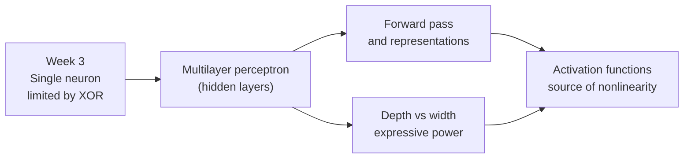

[Artificial Neural Networks](../../index.md) → Week 4: Multilayer Perceptrons and Activation Functions → Lesson 1: Introduction to MLPs and Activation Functions

---

# Introduction to MLPs and Activation Functions

## Key Concepts

### Where we are in the course
- Week 3: single neurons (perceptron, logistic neuron) are **linear classifiers**, and
  the XOR problem exposed their limit — single-layer models aren't expressive enough.
- ★ Fix: combine neurons into **multilayer networks**.

### What this week covers
- **MLP** — the simplest neural network with hidden layers.
- How hidden layers **transform data representations**.
- How information flows **forward** through an MLP.
- How **depth and width** control expressive power.
- **Activation functions** — the source of *all* nonlinearity in neural networks.

### Why it matters
- ★ MLPs are the conceptual foundation of deep learning. CNNs, RNNs and transformers
  all use the same core ideas: **layered computation + nonlinear activation**.
- Understanding MLPs and activations = learning the core language of deep learning.
