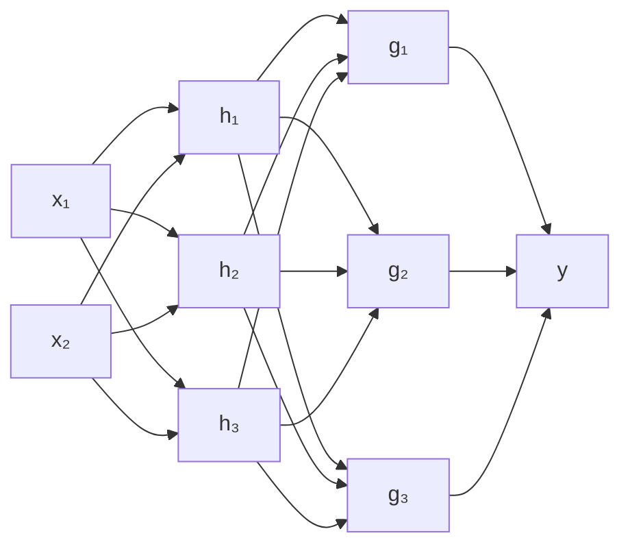
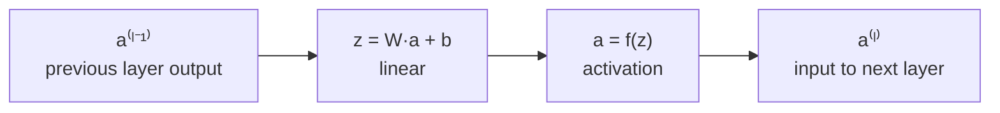
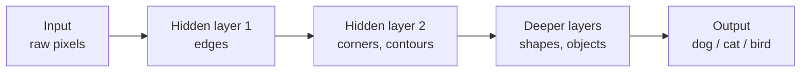
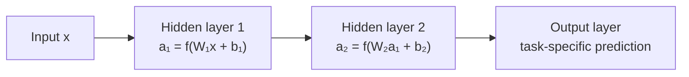

[Artificial Neural Networks](../../index.md) → Week 4: Multilayer Perceptrons and Activation Functions → Lesson 2: The Multilayer Perceptron

---

# The Multilayer Perceptron

## Key Concepts

### 1. What is a Multilayer Perceptron (MLP)

#### Definition
- An MLP is a **feed-forward neural network** made of three kinds of layers: an **input
  layer**, one or more **hidden layers**, and an **output layer**.
- Information flows strictly **one way**: input → hidden → output. No cycles, no
  feedback connections — that is what "feed-forward" means.

| Layer | Role |
|---|---|
| Input | Holds the raw feature vector. **No computation** — just a container |
| Hidden | Where the transformations happen; takes the previous layer's output and produces a new representation |
| Output | Takes the last hidden representation and produces the final prediction |

#### Fully connected architecture
- In a standard MLP every neuron in one layer sends its output to **every** neuron in
  the next layer.
- Example: 2 inputs (`x₁`, `x₂`) → hidden layer of 3 → hidden layer of 3 → 1 output `y`.

#### What a layer computes
- Every layer has a **weight matrix `W`** and a **bias vector `b`** — these parameters
  define the function the network computes.
- Each layer does two things:
    1. **Linear transformation:** `z⁽ˡ⁾ = W⁽ˡ⁾ a⁽ˡ⁻¹⁾ + b⁽ˡ⁾`
    2. **Nonlinear activation:** `a⁽ˡ⁾ = f(z⁽ˡ⁾)`
- `a⁽ˡ⁻¹⁾` is the previous layer's output; `a⁽ˡ⁾` is a **new representation** of the
  data and becomes the input to the next layer.

#### Shapes in a small example
- Input has 2 features, hidden layer has 3 neurons, output layer has 1 neuron.

| Item | Shape |
|---|---|
| Input `x` | 2 × 1 |
| `W₁` (hidden) | 3 × 2 |
| `b₁` | 3 × 1 |
| `W₁x + b₁` → `a₁` | 3 × 1 |
| `W₂` (output) | 1 × 3 |
| `W₂a₁ + b₂` → output | 1 × 1 |

- Inner dimensions must match (`3×2` times `2×1` ✓; `1×3` times `3×1` ✓).
- ★ The representation's **dimension changes** layer by layer — the network isn't just
  classifying, it is **reshaping the feature space** at each layer.

#### An MLP is a composition of functions
- Not one big formula but many simple transformations stacked:
  `a⁽ᴸ⁾ = f_L( f_{L−1}( … f₁(x) … ) )`
- Each layer refines the representation a little further; this repeated transformation
  is the source of the power of multilayer networks, and why MLPs are the core
  template for deep networks.

---

### 2. Role of Hidden Layers in Representation

#### Why hidden layers
- A single layer can only learn **linear** transformations, however many neurons it has
  — so only linear decision boundaries.
- Real-world relationships (images, speech, medical, financial data) are highly
  nonlinear. Hidden layers **re-encode the data** into internal representations in which
  complex patterns are easier to separate.

#### Representation learning
- *Representation* = how the data is encoded inside the network. The raw input (pixels,
  table values) is the first representation; each hidden layer gives a new one.
- Example (house price): inputs *bedrooms* and *size* together imply **spaciousness**.
  Spaciousness is not an input feature — it is abstract information learned in a hidden
  layer.
- ★ Learning isn't only about learning a classifier — it is also about learning **better
  internal representations**.

#### Hidden neuron as a feature detector
- A hidden neuron computes `a = f(wᵀx + b)` and responds strongly when a specific pattern
  appears in the input.
- Different neurons detect different patterns; together they form a **bank of feature
  detectors**.

| | Raw features | Derived features |
|---|---|---|
| What | Direct measurements (e.g. pixel intensities) | Created by hidden layers |
| Captures | Little on their own | Combinations, interactions between inputs, structural patterns |

- Each new layer works on features from the previous layer, not on the original input.

#### Hierarchical representation learning

- Early layers learn simple patterns (edges, basic numeric trends); deeper layers combine
  them into shapes, objects, abstract concepts.
- ★ One central reason deep networks beat shallow ones.

#### The trade-off
- More hidden neurons → more feature detectors. More hidden layers → more levels of
  abstraction. Together: a much larger set of representable functions.
- But also: more **parameters**, more **computational cost**, higher **risk of
  overfitting**. Managed later via training and regularisation.

#### XOR revisited
- XOR fails for a perceptron because no single line separates it.
- Hidden neurons create **multiple intermediate splits** of the input space; with the
  changed representation the two classes become separable.
- ★ Changing the representation in a hidden layer turns a linearly impossible problem
  into a solvable one. XOR is the smallest example of what all deep networks do.

---

### 3. Forward Pass in an MLP

#### Definition
- A **forward pass** = executing the stored computations of a (trained) network on a
  **single input** to produce a prediction. Every prediction comes from a forward pass.

#### Inside one neuron (4 steps)
1. Multiply each input by its weight.
2. Sum the weighted inputs.
3. Add the bias.
4. Apply the activation function: `z = Σ wᵢxᵢ + b`, `a = f(z)`.

- Pure numerical computation at run time — **no learning happens**.

#### Layer by layer

- ★ The original input is **never used again directly**; each layer only sees the
  transformed representation from the previous one.
- All neurons within a layer compute **in parallel**.

#### What the output layer produces
| Task | Output |
|---|---|
| Binary classification | A probability |
| Multi-class classification | Class scores / probabilities |
| Regression | A real-valued number |

#### Why it matters
- The forward pass is the core computation of a network (image recognition,
  recommenders, medical diagnosis…).
- Training repeats the same forward computation, then adjusts weights using the errors
  observed; backpropagation (later module) changes parameters and affects the next
  forward pass.

---

### 4. Expressive Power of MLPs

#### Definition
- **Expressive power** = the set of functions a model *can represent* (its capacity) —
  not yet about training or performance.
- Controlled by two structural choices: **depth** (number of layers) and **width**
  (neurons per layer).

#### Shallow vs deep
- *Shallow*: one hidden layer or none. *Deep*: multiple stacked hidden layers.
- Both can in principle approximate complex functions; they differ greatly in
  **efficiency**.

| | Width (more neurons, one layer) | Depth (more layers) |
|---|---|---|
| Effect | More feature detectors at **one** level of abstraction → finer partitions of input space | Hierarchical composition: simple features first, combined into complex ones |
| Cost | Neurons needed may grow **exponentially** | Many functions need **far fewer parameters** |

#### Universal approximation theorem
- A network with **even one hidden layer** can approximate any continuous function,
  given **enough neurons**.
- ★ Catch: the number of neurons required may be exponentially large — impractical.

#### Why depth wins in practice
- Deep, narrower networks are far more **parameter-efficient** — same class of functions
  with fewer neurons and parameters.
- Real problems are **hierarchical**: vision (edges → shapes → objects); language
  (characters → words → phrases → meaning). Deep networks match this composition, which
  is why they're so effective for vision, speech and language.
- Modern design favours **depth over extreme width**.
