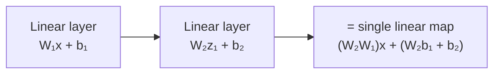
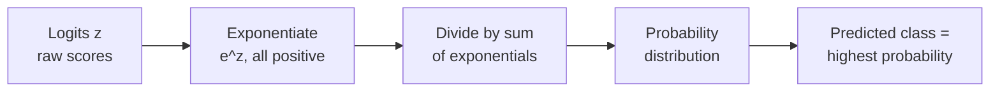
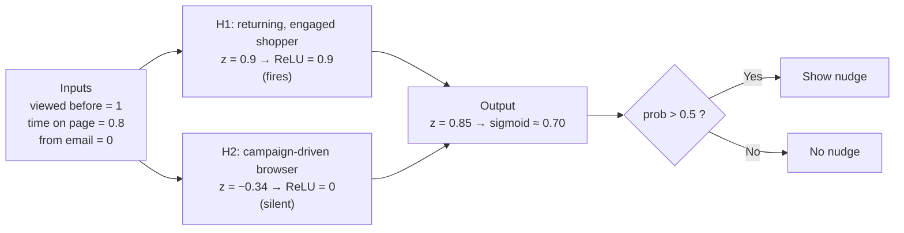

[Artificial Neural Networks](../../index.md) → <span class="week-crumb">Week 4: Multilayer Perceptrons and Activation Functions</span> → Lesson 3: Activation Functions

---

# Activation Functions

## Key Concepts

### 1. Why We Need Activation Functions

#### Stacked linear layers collapse
- Suppose every layer is only linear: `z = Wx + b`. Compose two layers:
    - `z₁ = W₁x + b₁`, `z₂ = W₂z₁ + b₂`
    - `z₂ = W₂(W₁x + b₁) + b₂ = (W₂W₁)x + (W₂b₁ + b₂)`
- That is **still one linear transformation** of `x`.
- ★ No matter how many purely linear layers are stacked, the network collapses into a
  **single linear model**. Depth alone gives no power if all layers are linear.



#### Consequence
- Purely linear models learn only straight-line boundaries / hyperplanes: no XOR-type
  patterns, no curved boundaries, no complex feature interactions — the same limit as
  the perceptron.

#### The fix: nonlinearity
- An activation function applies a **nonlinear transformation to each neuron's
  output**: `a = f(z)`. This breaks the linearity, so stacking no longer collapses.
- Layer 1 learns nonlinear features; layer 2 learns nonlinear combinations of those;
  deeper layers represent nested nonlinear relationships → curved boundaries, feature
  interactions, hierarchical abstractions.
- A neuron therefore does two things: **(1)** adds up weighted evidence,
  `z = w₁x₁ + w₂x₂ + … + b`; **(2)** applies an activation, `output = f(z)`.
- ★ Without activations an MLP is just **linear regression**, however deep. With them,
  even a single hidden layer can approximate any continuous function on a compact
  domain (**Universal Approximation Theorem**).
- The activation is applied **on top of** the linear step `z = Wa + b`, not instead of
  it. Different layers may use different activations (e.g. tanh in a hidden layer,
  sigmoid at the output), but once chosen for a layer it stays fixed.
- Mandatory in practice: without activations it is a linear model, not a neural network.

---

### 2. Sigmoid and Tanh

- The classical activation functions of the earliest neural networks: smooth, continuous
  nonlinearity. Their limits motivated ReLU.

#### Sigmoid
- `σ(z) = 1 / (1 + e⁻ᶻ)` — S-shaped, output in **(0, 1)**.
- Large positive `z` → ≈ 1; large negative `z` → ≈ 0; changes fastest around `z = 0`.
- Acts as a **soft yes/no** rather than a hard threshold, so the output reads as a
  probability. Closely tied to logistic regression.
- Worth memorising the formula: sigmoid is used widely, in classical data analysis as
  well as neural networks. At `z = 0` the output is 0.5.
- Binary classification output layer: one neuron gives one probability of belonging to
  the positive class — `sigmoid(w₁a₁ + w₂a₂ + w₃a₃ + b)`.

#### Tanh
- `tanh(z) = (eᶻ − e⁻ᶻ) / (eᶻ + e⁻ᶻ)` — S-shaped, output in **(−1, +1)**, **zero-centred**.
- A rescaled and shifted version of sigmoid.
- The (−1, +1) range works like normalisation, keeping hidden values from growing too
  large or too small — the reason it was used in hidden layers.
- Only suitable for **shallow** networks (about 3–4 layers); in deeper ones it saturates.

| | Sigmoid | Tanh |
|---|---|---|
| Output range | (0, 1) — always positive | (−1, +1) — centred on 0 |
| Zero-centred | No | Yes |
| Training behaviour | Less balanced | Zero-centred activations often optimise better |
| Classic use | Output layer, binary classification | Hidden layers of early networks (preferred over sigmoid there) |

#### Intuition and examples
| | Think of it as | Example |
|---|---|---|
| Sigmoid | **Probability dial** — "how confident is the yes?" | `z = 3` → ≈ 0.95 ("95% likely to click"); `z = −4` → ≈ 0.02 |
| Tanh | **Centred dial** — against / neutral / for | `z = 2` → ≈ +0.96; `z = −2` → ≈ −0.96; `z = 0` → 0 |

- Tanh suits hidden layers where **negative signal matters** (e.g. RNNs / LSTMs).
- Sigmoid's outputs never go negative.

#### Saturation
- For very large `|z|`, the output barely changes even if `z` changes a lot — the curve
  flattens.
- Gradients for such neurons become **very small** → a main contributor to the
  **vanishing gradient problem**.
- Why this hurts: the network should respond when its input changes, but a saturated
  neuron's output barely moves, so learning stalls. Gradients and the vanishing-gradient
  problem are covered in the next session (backpropagation).
- Sigmoid *can* be used in hidden layers, but tanh is better there; in practice sigmoid
  stays at the output layer.
- ★ Today both are used sparingly in hidden layers; sigmoid remains common at the
  output for binary classification.

---

### 3. The ReLU Family

#### Why ReLU was needed
- Sigmoid/tanh saturate → vanishing gradients → very deep networks were hard to train.
- Needed: stays nonlinear, avoids saturation over a large region, trains faster and more
  stably.

#### ReLU
- `f(z) = max(0, z)`: negative input → 0; positive input → `z`. Piecewise linear, very
  cheap to compute.
- It has a kink at 0 but is still usable for training — differentiating it causes no
  practical problems.
- Applied **on top of** the linear combination `Wa + b`, to bring in non-linearity.

| Why ReLU is the default | |
|---|---|
| No saturation for positive inputs | Information flows easily through many layers |
| Faster, more stable training | Compared with sigmoid / tanh |
| **Sparse activations** | Many neurons output exactly 0 → better generalisation, cheaper compute |
| Cheap to evaluate | Just a `max` |

#### Dying ReLU
- If a neuron's parameters drift so its input is **always negative**, it outputs 0 for
  every input and effectively **stops participating — a dead ReLU**.
- It can happen because of the data or the computation: some neurons keep getting a
  negative signal and become useless neurons that contribute nothing to learning. ReLU
  also ignores the whole negative side of its input, which motivated the variants below.

#### Variants
| | ReLU | Leaky ReLU | Parametric ReLU (PReLU) |
|---|---|---|---|
| Negative region | Exactly 0 | `αz`, α small & **fixed** (e.g. 0.01) | `αz`, α **learned** during training |
| Purpose | Simple, efficient default | Reduces dying-ReLU risk | Flexibility; small gains in some vision models |
| Cost | — | — | Slightly more parameters |

- PReLU costs one extra parameter `α` for every activation layer, learned on top of the
  weights and biases. Leaky ReLU is therefore the most common variant; PReLU is rarely
  used unless its gain justifies the added cost.
- Intuition: ReLU is a **bouncer** — blocks negatives, passes positives as is.
  `z = −5` → 0 (neuron silent); `z = 7` → 7 (neuron fires).
- All three keep the key benefits: nonlinearity, efficiency, stable deep training.
- **Guideline:** start with ReLU for almost all hidden layers; use Leaky ReLU if many
  neurons are inactive; PReLU only in specialised models where a small gain justifies
  extra parameters.

---

### 4. Softmax for Multi-Class Outputs

#### Why softmax
- Sigmoid suits **two** outcomes. With many classes (10 digits, many news topics,
  thousands of image categories) we need **one probability per class**, all
  non-negative and **summing to 1**. Softmax does this.
- The output layer then has **one neuron per class** (e.g. 3 for dog / cat / bird, 10 for
  handwritten digits 0–9), each giving that class's probability.
- Softmax is only a conversion of logits into probabilities, so it belongs in the
  **output layer only** — never in hidden layers.

#### Logits
- The raw outputs of the last linear layer. Can be positive or negative, small or
  large — **no probabilistic meaning** yet (unnormalised scores).

#### Definition
`softmax(zᵢ) = e^(zᵢ) / Σⱼ e^(zⱼ)`, for j = 1..K

- Properties: each output in (0, 1); outputs sum to 1; larger logit → larger probability.



#### Worked example
Logits `z = (2, 1, 0.1)`

| Class | `e^z` | Probability |
|---|---|---|
| 1 | 7.3 | 7.3 / 11.2 ≈ **0.66** |
| 2 | 2.7 | 2.7 / 11.2 ≈ **0.24** |
| 3 | 1.1 | 1.1 / 11.2 ≈ **0.10** |

- Sum of exponentials ≈ 11.2. Class 1 wins, but every class keeps some probability.
- **Close probabilities** (e.g. 0.41 vs 0.40): the model is effectively *confused*
  between the two classes. There is no hard rule; options are to pick either, flag the
  case as uncertain, or only act when the top class beats the runner-up by a chosen
  margin (a confidence threshold).

#### Intuition
- Exponentiation makes values positive; normalisation forces total mass to 1.
- Preserves **relative dominance**: a much larger logit gets a probability near 1, the
  rest get small ones — relative confidence becomes normalised probability.

#### Sigmoid vs softmax
| | Sigmoid | Softmax |
|---|---|---|
| Output | One probability | A vector, one probability per class |
| Interaction | Models one event in isolation | Probabilities **compete** (must sum to 1) |
| Use | Binary classification | Multi-class (mutually exclusive classes) |

- ★ Softmax generalises sigmoid from the binary to the multi-class case.

---

### 5. Worked Example: Same Neuron, Three Activations

#### One score, three outputs
| `z` | Sigmoid | Tanh | ReLU |
|---|---|---|---|
| 2 | ≈ 0.88 | ≈ 0.96 | 2 |
| −2 | ≈ 0.12 | ≈ −0.96 | 0 |

#### Real-time example: "free delivery" nudge
Score a live website visitor in milliseconds to decide whether to show a free-delivery
nudge.

- **Network:** 3 inputs → 2 hidden neurons (ReLU) → 1 output neuron (sigmoid).
- **Inputs:** viewed product before = 1, time on page (scaled) = 0.8, came from email
  campaign = 0.



- 0.70 means a 70% chance the visitor adds to basket → above 0.5, so show the nudge.

#### Swapping the hidden activation (same weights)
| Hidden activation | H1 | H2 | Final probability |
|---|---|---|---|
| ReLU | 0.90 | 0 | 0.70 |
| Tanh | 0.72 | −0.33 | 0.58 |
| Sigmoid | 0.71 | 0.42 | 0.71 |

- **ReLU** silences H2 cleanly.
- **Tanh** lets H2 push *against* the prediction (negative contribution).
- **Sigmoid** can't go below 0, so H2 still adds signal even though its evidence was
  negative — muddier.

#### Code
```python
import numpy as np

relu    = lambda z: np.maximum(0, z)
sigmoid = lambda z: 1 / (1 + np.exp(-z))

x  = np.array([1, 0.8, 0])
W1 = np.array([[0.9, 0.5, -0.3], [-0.6, 0.2, 0.7]])
b1 = np.array([-0.4, 0.1])
W2 = np.array([1.5, 0.8])
b2 = -0.5

hidden = relu(W1 @ x + b1)   # swap with np.tanh / sigmoid to compare
prob   = sigmoid(W2 @ hidden + b2)
print(hidden, round(prob, 2))  # [0.9 0.] 0.7
```
