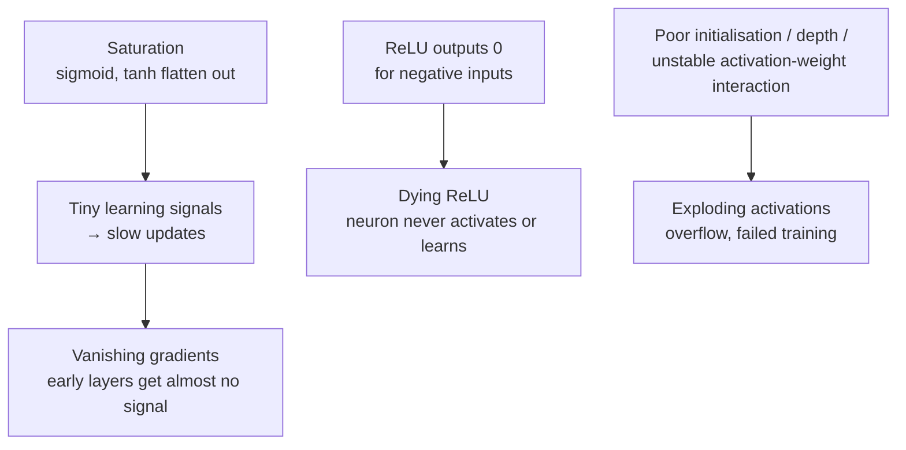

[Artificial Neural Networks](../../index.md) → Week 4: Multilayer Perceptrons and Activation Functions → Lesson 4: Activation Challenges and Practical Choices

---

# Activation Challenges and Practical Choices

## Key Concepts

### Why the choice matters
- Activations strongly influence how a network **trains, converges and stays stable**.
- A poor choice can mean very slow learning, unstable training, or no learning at all —
  it is a **core architectural decision**, not a minor detail.

### Main challenges

| Challenge | Cause | Effect |
|---|---|---|
| **Saturation** | Sigmoid/tanh flatten for large positive or negative inputs | Big input change → tiny output change; very weak learning signals; slow learning |
| **Vanishing gradients** | Backward signals through many layers multiply small values | Early layers learn almost nothing — worse the deeper the network (maths later) |
| **Dying ReLU** | Neuron always receives negative input | Outputs 0 forever, stops learning; reduces effective capacity (doesn't always occur) |
| **Exploding activations** | Poor weight initialisation, excessive depth, unstable activation–weight interaction | Very large activations → numerical overflow, training failure |

- ReLU solved saturation in the positive region but introduced dying ReLU.
- ★ Activation choice is tightly connected to **weight initialisation and depth**.

### Practical guidelines

#### Hidden layers
- Default to **ReLU**.
- Many dead/inactive neurons → try **Leaky ReLU**.
- Very deep networks → always prefer the **ReLU family**.
- **Avoid sigmoid** in deep hidden layers — it almost always slows or destabilises
  training.
- Need **zero-centred or negative values** in hidden layers (e.g. RNNs / LSTMs) → **tanh**.

**Rule of thumb:** hidden layers → ReLU · output layer, yes/no → sigmoid · zero-centred /
negative values needed → tanh. (See the free-delivery worked example in Lesson 3.)

**Order of trying things:** start with plain ReLU → check for dead neurons while training
→ if many, move to Leaky ReLU → use PReLU only if its gain justifies the extra parameter
(rarely done). Tanh is mostly "of the past": only for very shallow networks (3–4 layers),
otherwise use ReLU.

#### Output layer
Chosen by how you want to **interpret predictions**, not by training speed.

| Task | Output activation |
|---|---|
| Binary classification | Sigmoid |
| Multi-class classification | Softmax |
| Regression | Linear (no activation) |

### Trade-offs at a glance
| Function | Strength | Weakness |
|---|---|---|
| Sigmoid | Probabilistic output | Saturation |
| Tanh | Zero-centred | Still saturates |
| ReLU | Fast, stable | Dead neurons |
| Leaky ReLU / PReLU | Reduce dead-neuron risk | Slightly more design choices / parameters |
| Softmax | Essential for multi-class probabilities | Output layer only |

- ★ No single activation is perfect; each exists because of specific design goals and
  trade-offs. Good choices are a key reason deep networks are practical today.

### Exam and assignment focus
- ★ The **summary table above** (function → strength, weakness, where it is used) is very
  important for the exam. The formulas themselves are not required, but a data scientist
  should know **sigmoid and softmax** well, since both are used in classical analysis too.
- Assignment: given a dataset, build and train a neural network, choosing each layer's
  activation: **ReLU** in hidden layers, **sigmoid** at the output for binary
  classification, **softmax** for multi-class. Activations are mandatory — without them
  the model is just a linear model.
- Next session: **backpropagation** and how training proceeds (pre-read it), followed by
  a small demo of building a network on a dataset.
