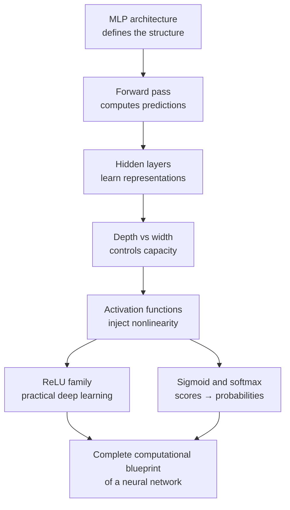

[Artificial Neural Networks](../../index.md) → Week 4: Multilayer Perceptrons and Activation Functions → Lesson 5: Module Summary

---

# Module Summary

## Key Concepts

### The big picture

### Key insights to carry forward
- Without activation functions, deep networks **collapse into simple linear models**.
- True expressive power = **depth + nonlinearity**.
- Different activation functions exist because of real **engineering trade-offs**.
- Output-layer activation must be chosen from the **type of prediction task**.
- ★ Good architecture and activation choices make deep learning practically possible.

### What's next — from network design to network learning
- The forward pass, loss computation and backpropagation as a complete **learning loop**
- How gradients propagate through layers using **computational graphs**
- How depth and **weight initialisation** affect training stability
- Loss functions: **MSE vs cross-entropy**
- Causes of **vanishing and exploding gradients**
- The end-to-end training process
