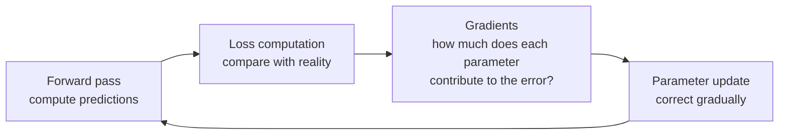

[Artificial Neural Networks](../../index.md) → Week 5: Backpropagation and Training Dynamics → Lesson 1: Introduction to Backpropagation and Training Dynamics

---

# Introduction to Backpropagation and Training Dynamics

## Key Concepts

### The question this week answers
- So far: network **structure** (MLPs, hidden layers, activation functions) and the
  **forward pass** that produces predictions.
- Open question: **how does a network improve itself using data?** When it makes a
  mistake, how does it know what went wrong and what to change?
- Training = adjusting the internal parameters (**weights and biases**) so predictions
  get better.

### The training loop

- ★ **Backpropagation** is the mathematical process that computes the gradients: it shows
  how **responsibility for the error is distributed** across the whole network.
- Four steps per training iteration: **(1)** forward pass with the current weights
  (random, from an initialisation method, or adjusted by an earlier update); **(2)** loss
  = a difference between true `y` and predicted `ŷ`; **(3)** backpropagation: attribute
  the error ("how much is `w₁` responsible, how much `w₂`?"); **(4)** parameter update /
  optimisation: change the weights to reduce the error. This week covers steps 1–3;
  optimisation (step 4) is the next session.

### What this week covers
- What backpropagation actually computes.
- How gradients flow through multiple layers.
- Why the **initial values of weights** matter for stability.
- How different **loss functions** influence learning.
- Why deep networks suffer from **vanishing and exploding gradients**, and how to
  diagnose and mitigate them.

### Conceptual shift
- Earlier weeks: structure, representations, forward computation.
- This week: **adaptation, learning and optimisation**. Forward computation, error
  signals and gradient-based parameter updates join into one learning process.
- This is where the mathematics behind learning truly begins.
