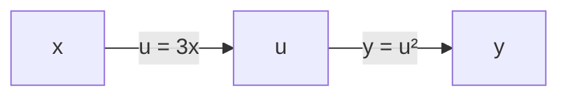
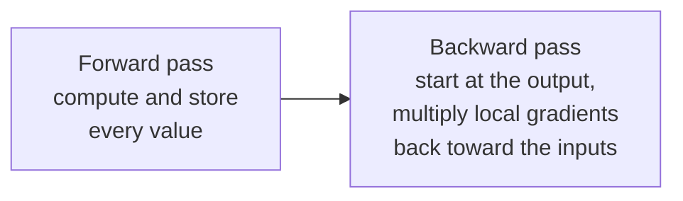
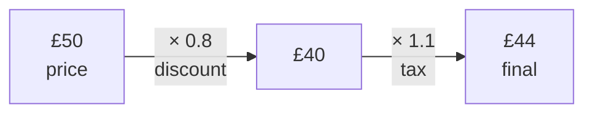
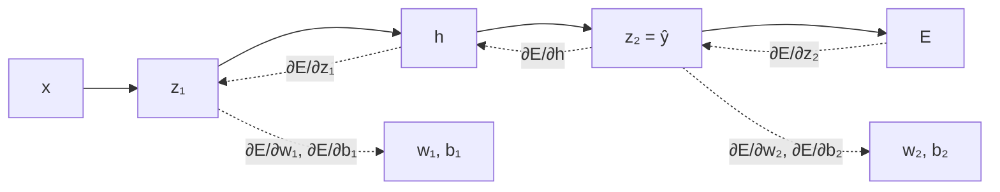

[Artificial Neural Networks](../../index.md) → Week 5: Backpropagation and Training Dynamics → Lesson 2: Backpropagation

---

# Backpropagation

## Key Concepts

### 1. What Backpropagation Actually Computes

#### The problem it solves
- A network has a huge number of parameters; a forward pass combines all of them into
  one prediction. If the prediction is wrong: **which parameters are responsible, and by
  how much?**
- Backpropagation computes a precise **responsibility signal for every parameter**.

#### The gradient as sensitivity
- For each parameter we need to know: should it **increase or decrease**, and **how
  strongly**?
- The **gradient** answers: *"If I change this parameter a little, how much does the
  error change?"* It is the partial derivative of the error with respect to the
  parameter.
- ★ Backpropagation does exactly one thing: it computes **one gradient per parameter**.
  These are the only information any learning algorithm needs to update parameters.

#### Reading a gradient
| Gradient of θ | Meaning |
|---|---|
| Positive | Increasing θ **increases** the error → decrease θ |
| Negative | Increasing θ **decreases** the error → increase θ |
| Zero | θ has no local effect on the error |
| Large magnitude | The error is **strongly sensitive** to θ |

- Comparing parameters: if `|∂E/∂w₁| > |∂E/∂w₂|`, changing `w₁` influences the error more
  than changing `w₂`.
- We compute `∂E/∂·` for **every** weight and bias in the network, because each is a
  dial we may need to change.
- Works for classification too: `ŷ` is a probability in (0, 1), and the loss measures the
  distance between it and the true 0/1 label (e.g. 0.8 is closer to 1 than 0.3 is).

#### Derivative from scratch
- A **derivative** is a **slope**: how much the output changes per tiny nudge of the
  input (like "degrees per turn" of a shower tap). Slope = rise ÷ run:
  `[f(x + h) − f(x)] / h`, with the nudge `h` shrinking toward 0.
- Derivation for `f(x) = x²`:
    - `[(x + h)² − x²] / h = (2xh + h²) / h = 2x + h`
    - As `h → 0` the leftover `h` vanishes → **`d(x²)/dx = 2x`**.
    - Check: at `x = 3`, nudging to `3.01` raises `x²` from 9 to 9.0601, a rise of
      0.0601 over 0.01 ≈ 6.01 ≈ `2x = 6` ✓.

| Function | Derivative |
|---|---|
| `c·x` (a line) | `c` |
| `x²` | `2x` |
| constant | `0` |
| `ReLU(z)` | 1 if `z > 0`, else 0 |

- **Chain rule** (effects multiply, like bicycle gears: 3 wheel turns per pedal turn × 2
  tyre spins per wheel turn = 6): for `y = u²`, `u = 3x`, `dy/dx = (dy/du)(du/dx) =
  2u · 3 = 6u`.
- Applied to the next example: `E = (wx − 10)²` with `u = wx − 10` gives
  `dE/dw = 2u · x = 2(wx − 10)·x`.
- ★ A **gradient** is just the derivative for **every** weight at once.

#### Worked example: one parameter
- Model `ŷ = w·x`, with `x = 2` and true `y = 10`. Start with a random `w = 1`.
- Error: `E = (y − ŷ)² = (wx − 10)²`.
- Gradient: `∂E/∂w = 2(wx − 10)·x`.

| | Value |
|---|---|
| Prediction `ŷ = 1 × 2` | 2 |
| Error `E = (2 − 10)²` | 64 |
| Gradient `∂E/∂w = 2(2 − 10)·2` | **−32** |

- Negative → increasing `w` reduces the error. Magnitude 32 → the error reacts strongly
  to `w`. One number gives both the **direction** and the **strength**.

#### Backpropagation is not optimisation
- ★ Backpropagation **does not learn** — it only supplies the gradients.
- Every training algorithm, from basic gradient descent to modern optimisers, starts from
  these gradients. Without gradients, learning cannot proceed.

---

### 2. Computational Graphs

#### Definition
- A **computational graph** represents a mathematical expression: **nodes** are
  variables or intermediate values, and the **edges** are the operations that transform
  one value into another.
- Example: `u = 3x`, `y = u²`.

#### Forward pass on a graph
- Evaluate each node in order: `x` → `u = 3x` → `y = u²`.
- ★ Every intermediate value is **stored**, because it is reused during the backward
  pass.

#### Local gradients and the chain rule
- A **local gradient** = the derivative of a node's output with respect to its **direct
  input**.
    - `du/dx = 3`
    - `dy/du = 2u`
- ★ A **global gradient is the product of local gradients along a path**:
  `dy/dx = (dy/du) · (du/dx) = 2u · 3`.
- Check with `x = 2`: `u = 6`, `dy/du = 12`, `dy/dx = 12 × 3 = 36` (same as differentiating
  `y = 9x²` directly: `18x = 36`).
- In the graph, **nodes store the values** (`x`, `u`, `y`) and **edges store the
  operations** and their local gradients (`dy/du`, `du/dx`). To get `dy/dx`, walk
  backward from `y` to `x` and multiply the local gradients **on that path only**;
  edges elsewhere in a bigger graph are ignored.
- This tiny graph goes back to the input only to illustrate; in a real network the
  gradients we want are those for the **weights**, not the inputs.
- Why bother: to reduce the error we must know how much each weight contributes to it.
  The cycle is: forward pass → deviation from the true value → backward pass computes each
  parameter's gradient → adjust weights → forward pass again with a smaller deviation.

#### One graph, two passes

- The same static graph supports both the computation and the differentiation.
- Backpropagation is simply the **systematic backward traversal** of the computational
  graph, which is what makes it efficient for large networks.

#### Layman analogy: shop price
- A computational graph is a **flowchart of a calculation**, each small step in its own
  box. Final price of a £50 item with a 20% discount, then 10% tax:

- **Forward pass:** walk left to right, compute each box and **write down every
  intermediate value** (the £40).
- **Backward pass:** "if the price changes by £1, how much does the final price change?"
  Walk backwards and multiply each arrow's effect: tax step ×1.1, discount step ×0.8 →
  `0.8 × 1.1 = 0.88`, so each £1 of price moves the final price by £0.88.
- Each arrow's effect is a **local gradient**; multiplying them along the path is the
  **chain rule**.
- In a neural network the "calculation" is weights, biases and activations over many
  layers, the end result is the **loss**, and the backward pass gives **a gradient for
  every weight**.
- Memory aid: a game of telephone. When the final message is wrong, walk back down the
  line asking how much each person distorted it; their shares multiply along the line.

---

### 3. Backpropagation Step by Step

#### The network
- Simplest non-trivial network: one input, **one hidden neuron**, one output neuron
  (a "two-layer" network: one hidden layer + one output layer).
- `z₁ = w₁x + b₁`, `h = σ(z₁)`, `z₂ = w₂h + b₂`, `ŷ = z₂`, error `E(ŷ)`.

#### Forward pass: cache everything
- Compute and **store** `x, z₁, h, z₂, ŷ`. These cached values make the backward pass
  possible.
- Goal: the four gradients `∂E/∂w₂`, `∂E/∂b₂`, `∂E/∂w₁`, `∂E/∂b₁`.

#### Backward pass, step by step
| Step | Gradient | Chain rule | Note |
|---|---|---|---|
| 1. Start at the output | `∂E/∂ŷ = ∂E/∂z₂` | since `ŷ = z₂` | The initial signal that gets propagated back |
| 2. Output-layer weight | `∂E/∂w₂` | `∂E/∂z₂ · h` | `∂z₂/∂w₂ = h` |
| 3. Output-layer bias | `∂E/∂b₂` | `∂E/∂z₂ · 1` | `∂z₂/∂b₂ = 1` |
| 4. To the hidden activation | `∂E/∂h` | `∂E/∂z₂ · w₂` | How much the hidden neuron contributed to the error |
| 5. Through the activation | `∂E/∂z₁` | `∂E/∂h · σ′(z₁)` | ★ The activation's derivative shapes gradient flow |
| 6. First-layer weight | `∂E/∂w₁` | `∂E/∂z₁ · x` | `∂z₁/∂w₁ = x` |
| 7. First-layer bias | `∂E/∂b₁` | `∂E/∂z₁ · 1` | `∂z₁/∂b₁ = 1` |

- Forward: values flow `x → z₁ → h → z₂ → ŷ → E`. Backward: gradients flow
  `E → z₂ → h → z₁`, and at each layer's pre-activation they branch off to that layer's
  weights and bias.
- The hidden layer **never sees the error directly**; it only receives the propagated
  responsibility signal.
- The same network used for prediction is **reused in reverse** to assign responsibility.

#### What this video does *not* do
- No parameter update, no learning rate, no optimisation algorithm — backpropagation is
  only the gradient-computation step. Updates come later with optimisers.
- ★ Even this tiny network shows the complete structure of deep backpropagation; very
  deep networks just extend the same idea.

#### Numeric example (ReLU, no biases)
- Network: `x → ×w₁ → z₁ → ReLU → h → ×w₂ → ŷ`, error `E = (ŷ − 10)²`, with `x = 2`,
  `w₁ = 1`, `w₂ = 1`.
- **Forward (save every value):** `z₁ = 2`, `h = 2`, `ŷ = 2`, `E = 64`.
- **Backward:**

| Step | Question | Answer |
|---|---|---|
| 1 | `∂E/∂ŷ` | `2(ŷ − 10) = −16` |
| 2 | `∂E/∂w₂` | `−16 × h = −32` |
| 3 | `∂E/∂h` | `−16 × w₂ = −16` |
| 4 | `∂E/∂z₁` (ReLU′ = 1 since `z₁ > 0`) | `−16 × 1 = −16` |
| 5 | `∂E/∂w₁` | `−16 × x = −32` |

- Both gradients are negative → both weights should **increase**. Taking one step with
  learning rate 0.01 (`w ← w − 0.01 × gradient`, covered with optimisers): both become
  1.32. New forward pass: `z₁ = h = 2.64`, `ŷ ≈ 3.48`, `E ≈ 42` — down from 64.
- `w₁` never sees the target: its blame is **passed back** through `w₂` and the ReLU. If
  the activation's derivative were ≈ 0, the whole signal behind it would be zeroed out,
  which is the root of vanishing gradients.

#### Practical points from the live class
- **Why compute intermediate gradients** (`∂E/∂z₁`, `∂E/∂h`) when we only want the four
  parameter gradients? Because the chain rule needs them: `∂E/∂w₁ = ∂E/∂z₁ · ∂z₁/∂w₁`,
  and `∂E/∂z₁` itself was built from `∂E/∂h`.
- **Where the first gradient comes from:** the loss has a known functional form, so
  `∂E/∂ŷ` can always be written down (for squared error, `2(ŷ − y)` for one point). If the
  output also has an activation (`h₂ = σ(z₂)`), start at `∂E/∂h₂` and chain back through
  it. The lecture left the output activation out for simplicity.
- **Each local derivative is known in closed form** (e.g. `∂z₂/∂w₂ = h`), so nothing needs
  to be fitted from data. Frameworks apply the chain rule automatically, even for
  high-order functions, so you do not differentiate by hand.
- **Many weights:** with several neurons per layer you take the derivative with respect
  to **every** weight (the lecture used one neuron per layer only to keep the maths
  easy). Example: 4 inputs → 5 hidden → 5 hidden → 1 output has `20 + 25 + 5` weights plus
  biases, all getting a gradient and then an update.
- **One iteration with data:** feed a data point (or a **batch** of 1 to *n* points), do
  the forward pass, backpropagate, update all parameters, then repeat with the next
  data/batch. Typical batch sizes are multiples of 2 (32, 64, 128); no mathematical
  reason for this was given in class. Gradients differ between batches, and retraining
  can give slightly different results, which is acceptable in neural networks.
- You never adjust weights by hand; optimisation algorithms and packages do it
  (next session).
