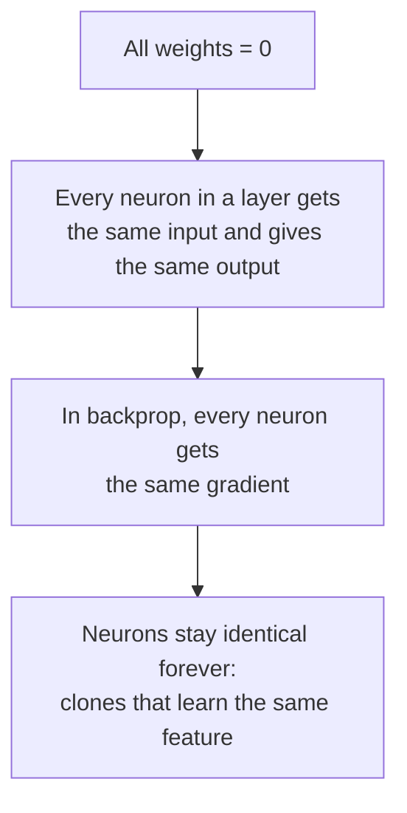

[Artificial Neural Networks](../../index.md) → Week 5: Backpropagation and Training Dynamics → Lesson 3: Gradient Flow and Initialisation

---

# Gradient Flow and Initialisation

## Key Concepts

### 1. Why Gradient Flow Matters in Deep Networks

#### What gradient flow is
- Gradients travel **backward** from the output layer to the first layer. This backward
  movement is **gradient flow**.
- ★ A layer can only learn if a **usable gradient actually reaches it**.
- Good flow: gradients reach all layers with a meaningful size and stable direction, so
  all layers learn together. Poor flow: gradients become extremely small or extremely
  large, and learning breaks down. Gradient flow is a **health indicator for training**.

#### Why depth causes the problem
- At every layer the gradient is multiplied by a **local derivative**, so an early
  layer's gradient is a **product of many numbers**.
- Mostly < 1 → gradients **shrink** exponentially; mostly > 1 → they **grow**
  exponentially, with depth.
- This is a fundamental mathematical consequence of depth, not a software or hardware
  problem.

#### The two failure modes
| | Vanishing gradients | Exploding gradients |
|---|---|---|
| Gradient size | Extremely close to 0 | Extremely large |
| Effect | Early layers get almost no learning signal; training is very slow or stuck | Parameter updates become unstable; training diverges numerically |

- The earliest layers are **farthest from the error**, so they receive gradients after the
  most multiplications.
- Common failure mode: a deep network **behaves like a shallow one**, because the early
  layers never truly learn.

#### Gradient flow as a diagnostic
- Healthy training: gradients across layers stay reasonably scaled; no layer is starved.
- Unhealthy: gradients collapse to 0 in early layers, or blow up unpredictably.
- Practitioners often **monitor gradient norms across layers** to catch this early.
- What determines health: the **activation function**, **weight initialisation**,
  **network depth**, and even **numerical precision**.
- ★ Most training failures in deep networks are ultimately gradient flow failures.
- What "good" means: gradients reaching early layers have a **meaningful magnitude**
  *and* a **stable direction**. If a gradient flips sign randomly between iterations the
  weights just hover around a point. If it is near 0, updates don't change the error; if
  it is huge you get infinities and numerical instability.
- Of the four factors, **activation function, initialisation and depth** matter most for
  network design; numerical precision is usually a fixed standard.
- Sigmoid/tanh example: on the flat ends of the S-curve the slope is ≈ 0, so moving a
  weight there barely changes the output.

---

### 2. Weight and Bias Initialisation

#### Why it matters
- Training starts with the network knowing nothing: every weight and bias needs an initial
  value. These decide how activations and gradients scale, and whether learning starts
  smoothly or fails immediately.
- Bad initialisation can block learning completely; good initialisation makes deep
  networks trainable.

#### Why not all zeros? Symmetry

- This is the **symmetry-breaking problem**: weights must never be initialised to zero.
- Chain of effect: initial weights set the size of `z₁`, which sets the size of the
  activation `h`, which sets the gradient size and so the stability of learning. With all
  weights 0, `z₁ = z₂ = 0`: both neurons learn the same thing, so the layer's expressive
  power is poor.
- **Biases are different:** a bias does not multiply inputs, so it does not create
  symmetry. `b = 0` is standard practice. (With ReLU, a small positive bias is sometimes
  used to avoid dead neurons, but it is optional.)

#### What makes an initialisation good
- Activations should neither blow up nor collapse to 0, and gradients should keep a
  healthy size across layers.
- ★ The idea behind modern methods: **preserve stable variance** in both the forward and
  backward passes.

#### Naive random initialisation
- Drawing `w ~ N(0, σ²)`:
    - `σ` too small → weighted sums shrink, activations shrink layer by layer → vanishing
      gradients.
    - `σ` too large → weighted sums explode → huge activations → exploding gradients.
    - (`σ²` here is the **variance** of the normal distribution, not the sigmoid.)
- Plain `N(0, σ²)` is acceptable for small networks (2–3 layers) but not for deeper ones.
- A layer computes `z = Σ wᵢxᵢ`; its variance depends on the number of inputs, the input
  variance and the weight variance. Across many layers this keeps being multiplied, so it
  grows or shrinks **exponentially**.
- Analogy: a note passed down a line of singers, each making it louder or quieter.

| Each layer scales the signal by | After 20 layers | Result |
|---|---|---|
| 0.5 (weights too small) | 0.5²⁰ ≈ 10⁻⁶ | Signal fades; gradients vanish |
| 1.5 (weights too large) | 1.5²⁰ ≈ 3,300 | Signal blows up; gradients explode |
| ≈ 1.0 | ≈ 1 | Healthy |

- Goal of a good initialisation: each layer keeps the signal's size **roughly constant**,
  forward and backward.
- Why variance depends on `n_in`: `z = w₁x₁ + … + wₙxₙ` sums `n` terms, so more inputs
  give a bigger spread, so the weights must be **smaller when there are more inputs**.
  Example with He: 100 inputs → variance 2/100 = 0.02 (std ≈ 0.14); 1,000 inputs →
  variance 0.002.

#### Xavier (Glorot) vs He initialisation
| | Xavier (Glorot) | He |
|---|---|---|
| Designed for | **Sigmoid and tanh** | **ReLU family** |
| Gaussian form | `w ~ N(0, 1/n_in)` | `w ~ N(0, 2/n_in)` |
| Uniform form | A uniform range set from `n_in` and `n_out` | — |
| Idea | Keep activation and gradient variance stable across layers | Factor 2 compensates for ReLU zeroing roughly half the inputs |

- `n_in` = neurons feeding the layer (the previous layer); `n_out` = neurons in this
  layer.
- Xavier is **not ideal for ReLU**: ReLU zeroes about half the inputs, cutting the signal
  variance in half. He initialisation corrects this.
- Modern deep networks with ReLU and its variants almost always use **He initialisation**.
- Standard uniform form of Xavier: `w ~ U(−√(6/(n_in + n_out)), +√(6/(n_in + n_out)))`.
  The live class confirmed the bounds come from `6 / (n_in + n_out)`; the derivation is
  out of scope. Xavier is used for **sigmoid, tanh and linear layers**; He is essentially
  the same idea with `1` replaced by `2`, for ReLU.

#### Summary
- Zero weights break learning (symmetry), but zero bias is usually fine.
- Naive random initialisation often leads to vanishing or exploding gradients.
- Xavier → tanh/sigmoid networks; He → ReLU-family networks.
- Poor initialisation: immediate vanishing/exploding gradients, flat loss curves,
  instability or divergence. Good initialisation: smooth early learning, stable gradient
  flow, faster convergence. ★ It is the **foundation** of model training, not a tuning
  detail.
