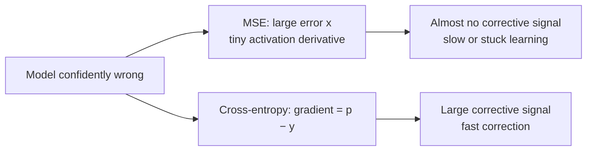

[Artificial Neural Networks](../../index.md) → Week 5: Backpropagation and Training Dynamics → Lesson 4: Loss Functions

---

# Loss Functions

## Key Concepts

### 1. Mean Squared Error (MSE) Loss

#### Why a loss function
- A **loss function** turns "how wrong is this prediction?" into a single number.
  Backpropagation uses that number to compute gradients and update weights.
- Different tasks need different losses.
- ★ The loss supplies the **starting gradient** `∂E/∂ŷ` for backpropagation, so its
  formula decides what flows backward.

#### MSE
- `MSE = (1/n) Σ (y − ŷ)²` — take the error, **square** it, **average** it.
- A smooth, always non-negative measure of distance; geometrically, the **squared
  distance** between the true and predicted point.

#### Example
- True `y = 5`, predictions 4 and 2:
    - `(5 − 4)² = 1`, `(5 − 2)² = 9` → average = **5**.
- ★ Squaring punishes **large errors much more strongly** than small ones.
- Order of operations: find the error, square it, then average over the batch (e.g. add
  up 32 squared errors and divide by 32).
- Error 1 → 1, but error 4 → 16: the error grew 4×, the penalty 16×. Negative errors
  count the same, since squares are non-negative.
- MSE is **convex** and differentiable, so it is easy to optimise. For one point,
  `∂E/∂ŷ = 2(ŷ − y)` is the gradient that starts backpropagation.

#### When to use it
- Default loss for **regression** (continuous outputs): house prices, temperature
  forecasts, sensor readings, energy consumption, autoencoders (reconstructing inputs).
- Poor for classification (next video).

---

### 2. Cross-Entropy and Softmax

#### Why MSE fails for classification
| Problem | Explanation |
|---|---|
| Wrong geometry | Treats class labels as numbers on a line (0, 1, 2), but class 2 is not "twice" class 1: there is no natural numeric distance between classes → poor decision boundaries |
| Weak penalty for confident mistakes | True class = 1: predicting 0.9 gives MSE 0.01; predicting 0.1 gives 0.81 — both small, so the feedback is weak |
| Tiny gradients with sigmoid/softmax | These saturate near 0 and 1, so their derivatives are tiny. With `y = 1` and `ŷ = 0.99` the loss is only 0.0001, and a confidently wrong model gets almost no corrective signal |

#### Softmax recap
- A network outputs raw scores called **logits** (any sign, don't sum to 1). Softmax turns
  them into a probability distribution:
  `pᵢ = e^(zᵢ) / Σⱼ e^(zⱼ)`.
- Every output is positive and all outputs sum to 1; a larger logit gets a higher
  probability. (The numerically stable version was covered in the maths module.)

#### Cross-entropy
- For true class `y`: `CE = −log(p_y)` — how **surprised** the model is that the true
  class occurred.

| Probability given to the true class (cat) | Loss | Reading |
|---|---|---|
| 0.90 | ≈ 0.1 | Almost perfect |
| 0.50 | ≈ 0.69 | Unsure |
| 0.01 | ≈ 4.6 | Confidently wrong: loss shoots up |

- Message to the model: *if you are confidently wrong, correct aggressively.*
- Side-by-side, true label 1: **MSE** goes from 0.01 (prediction 0.9) to only 0.81
  (prediction 0.1); **cross-entropy** goes from ≈ 0.1 to ≈ **2.3**. The much larger loss
  gives a usable signal when it propagates backward.
- Cross-entropy is just `−log` of the probability the model gave the true class. It is
  *not* the sigmoid (`1 / (1 + e⁻ᶻ)`), though the two are related: the log-odds
  `log(p / (1 − p))` is the inverse of sigmoid.

#### Softmax + cross-entropy together
- In practice they are computed as **one expression**:
  `loss = −z_y + log Σⱼ e^(zⱼ)`. This avoids extra computation and is numerically stable.
- PyTorch and TensorFlow implement this internally: calling `CrossEntropyLoss` already
  **includes the softmax**.
- ★ Softmax + cross-entropy is the **default for classification**: strong, well-shaped
  gradients; pushes probability toward the correct class; heavily penalises confident
  mistakes; scales to many classes; trains faster and more reliably than MSE. Used in
  CNNs, RNNs, transformers and almost every modern classifier.

---

### 3. How Loss Influences Gradient Signals

#### The loss shapes the gradients
- Pipeline: forward pass → loss → backpropagation → weight update.
- The loss is not just a measure of error: different losses give different gradient
  **magnitudes and directions**, which changes how fast and how well a model learns.

#### MSE vs cross-entropy gradients
| | MSE (classifier) | Cross-entropy + softmax |
|---|---|---|
| Gradient | ≈ error × **activation derivative** | ≈ **`p − y`** (predicted probability − target) |
| Problem / benefit | The activation derivative is tiny when outputs sit near 0 or 1 → dampens the signal | No extra tiny multiplier; direct and larger corrections |

#### Cases
| Situation | MSE gradient | Cross-entropy gradient |
|---|---|---|
| **Unsure** (p ≈ 0.5 for the true class) | error 0.5 × derivative 0.25 = **0.125** (moderate) | `p − y` = **−0.5** (stronger push) |
| **Confidently wrong** (p ≈ 0.01) | error 0.99 × tiny derivative (≈ 0.01 at that saturation point) ≈ **~0** | **−0.99** (very large correction) |
| **Confident and correct** | Small | Small (appropriate: only fine-tuning needed) |

- ★ The key difference: cross-entropy **aggressively punishes confident wrong answers**;
  MSE often does not, because the saturated activation derivative cancels the large
  error. MSE can leave a confidently wrong classifier **stuck**.

- Conceptual plot (gradient magnitude vs predicted probability `p`): cross-entropy
  starts high when `p` is small and declines smoothly toward 0 as `p` rises; MSE peaks
  near the middle and is very small at the edges.
- Empirically, classifiers trained with softmax + cross-entropy converge faster and reach
  better performance than the same models trained with MSE.
- ★ Choosing the loss is a **design decision** that directly affects learning dynamics.

#### Choosing a loss
| Task | Loss |
|---|---|
| Regression | MSE |
| Classification (binary or multi-class) | Softmax + cross-entropy |
