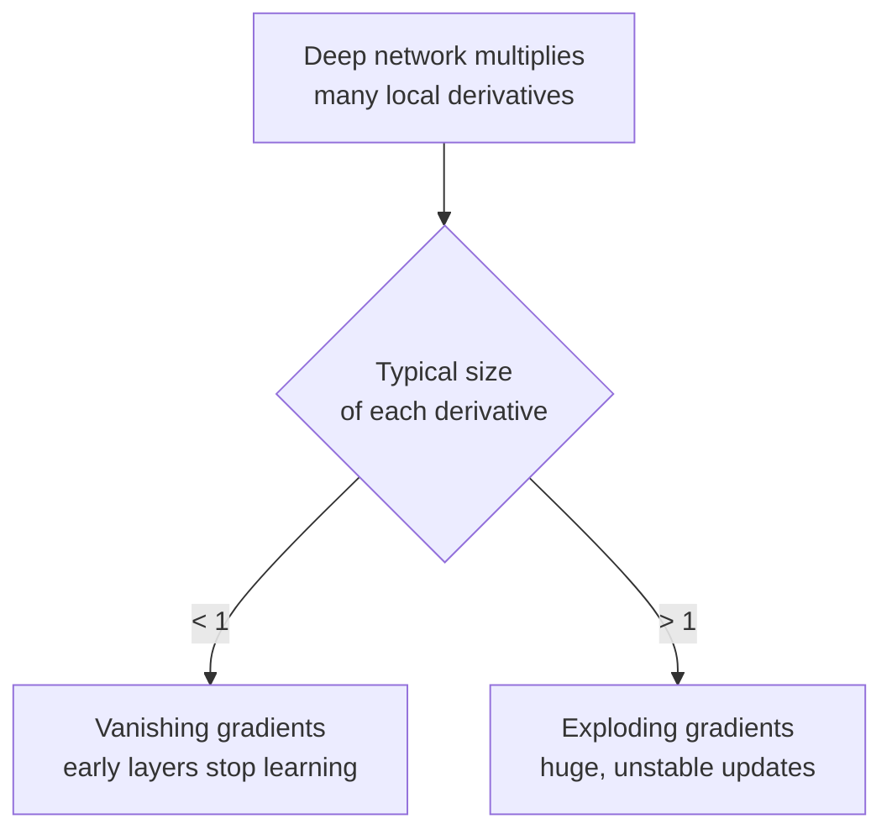
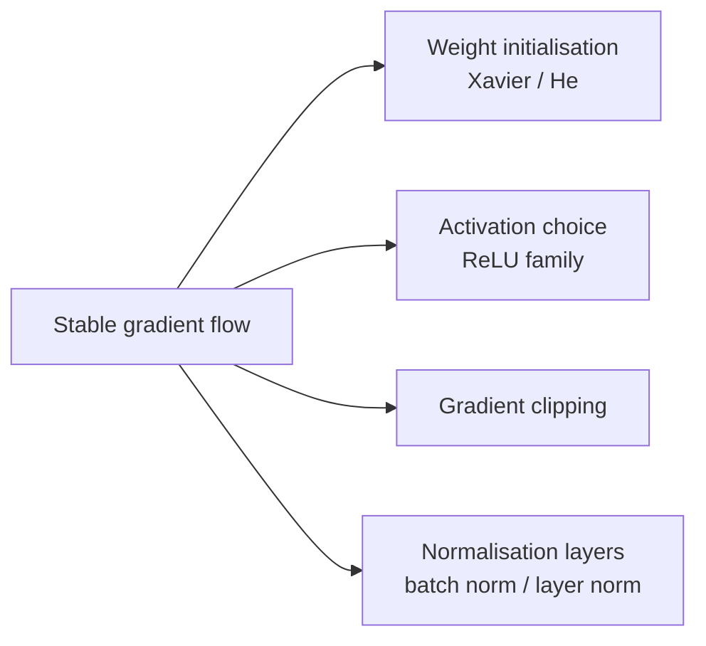

[Artificial Neural Networks](../../index.md) → Week 5: Backpropagation and Training Dynamics → Lesson 5: Vanishing and Exploding Gradients

---

# Vanishing and Exploding Gradients

## Key Concepts

### 1. Vanishing and Exploding Gradients

#### Where they come from
- During backpropagation each layer contributes a local derivative, and the chain rule
  **multiplies** them. The gradient for an early layer is a product of all the local
  derivatives between it and the loss.
- Mostly < 1 → the gradient **shrinks** as it travels backward. Mostly > 1 → it **grows**
  rapidly.

#### Vanishing gradients
- Causes:
    - **Saturating activations** (sigmoid, tanh): derivatives become tiny.
    - **Weights initialised too small**: activations stay small, and so do the derivatives.
- Numbers: each derivative ≈ 0.5, 20 layers → `0.5²⁰ ≈ 10⁻⁶`, almost zero. Lower layers
  get almost no signal and stop learning.

#### Exploding gradients
- Causes: **weights too large**, or activations that amplify inputs instead of
  controlling them.
- Numbers: each layer multiplies by about 1.5, 20 layers → `1.5²⁰ ≈ 3300`. Weight updates
  become enormous; the model becomes unstable or diverges.

#### Role of the activation function
| Activation | Derivative | Effect |
|---|---|---|
| Sigmoid | Never above **0.25**; near 0 when saturated | Strongly encourages vanishing gradients |
| Tanh | Zero-centred, but still saturates (derivatives near 0) | Still prone to vanishing |
| ReLU | Either **0 or 1** | Doesn't shrink gradients; but with large weights even ReLU networks can explode |

- ★ The choice of activation directly affects gradient flow.

#### Symptoms
| Vanishing | Exploding |
|---|---|
| First few layers barely change | Loss suddenly spikes or becomes `NaN` |
| Training accuracy plateaus very early | Weight values grow extremely large |
| Loss decreases extremely slowly | Updates look chaotic and unstable |

- **How to diagnose:** watch the training loss across epochs. If it doesn't follow a
  stable pattern, suspect vanishing or exploding gradients, then inspect the gradient
  values layer by layer. Practical debugging comes later in the course.
- ReLU avoids the vanishing problem, but its output is unbounded on the positive side, so
  with large weights it is the activation where **exploding** gradients typically show up.
  Gradient clipping and normalisation layers are the remedies for that.

---

### 2. Techniques to Mitigate Vanishing and Exploding Gradients

#### The four tools

#### 1. Weight initialisation
- **Xavier (Glorot):** keeps activation and gradient variance consistent across layers;
  works well with sigmoid and tanh.
- **He:** the same idea scaled for ReLU-type activations: variance `2 / n_in`, to
  compensate for ReLU blocking half the inputs.
- Goal: keep the forward and backward signal from shrinking or exploding. Without good
  initialisation, the other techniques are much less effective.

#### 2. Activation functions
- Sigmoid/tanh saturate easily (derivatives near 0), which is why deep sigmoid networks
  used to be so hard to train.
- **ReLU** has derivative **1 for positive inputs**, so gradients pass cleanly. Leaky ReLU,
  GELU and other variants extend this idea.
- ★ Using the right activation greatly reduces the vanishing-gradient risk, and is a big
  part of why deep learning became feasible.

#### 3. Gradient clipping
- Targets **exploding** gradients: if the gradient norm exceeds a preset limit, scale it
  down so updates stay controlled.
- Widely used in RNNs, LSTMs and transformers. Think of it as a **safety cap** on
  gradient size.

#### 4. Normalisation layers
| | Batch normalisation | Layer normalisation |
|---|---|---|
| What it does | Normalises activations **within a batch** | Normalises at the **feature level** (per sample) |
| Where it is common | Deep feed-forward and convolutional networks | **Transformers**, where batch statistics aren't always reliable |

- Both keep activations in a healthy range, which keeps derivatives in a healthy range.
  Batch norm also reduces **internal covariate shift** and helps deeper networks train.
- Stabilise both the forward and backward pass, helping against vanishing *and* exploding
  gradients.

#### Summary
| Problem | Main remedies |
|---|---|
| Vanishing | Good initialisation, ReLU family, normalisation layers |
| Exploding | Good initialisation, gradient clipping, normalisation layers |
