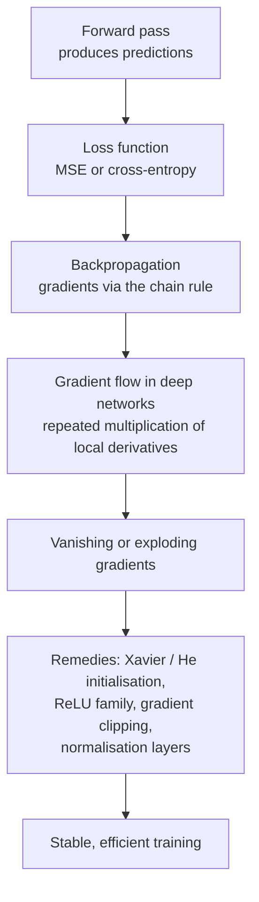

[Artificial Neural Networks](../../index.md) → Week 5: Backpropagation and Training Dynamics → Lesson 6: Module Summary

---

# Module Summary

## Key Concepts

### The big picture

### Key insights to carry forward
- Backpropagation computes **gradients of the error for every parameter** using the chain
  rule; it does not update anything itself.
- Gradients depend directly on the **loss function**, which is why MSE and cross-entropy
  behave so differently in practice.
- In deep networks, **repeated multiplication of local derivatives** makes gradients
  vanish or explode.
- Practical remedies: **Xavier and He initialisation**, **ReLU-family activations**,
  **gradient clipping**, **normalisation layers**.
- ★ These tools form the core of modern deep learning practice, and explain **why**
  certain architectures and training techniques are necessary for stable learning.

### What's next — from gradients to optimisation
- How we **optimise** with gradients: optimisers such as **Momentum, RMSProp, Adam**.
- **Learning-rate scheduling**.
- The practical dynamics of training deep networks: debugging, speeding up and
  stabilising training in real-world applications.
