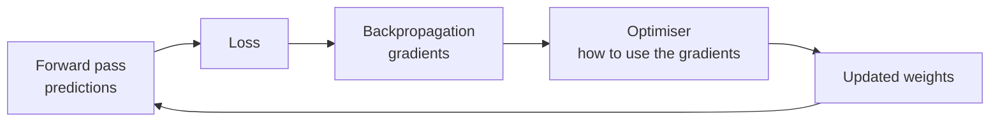
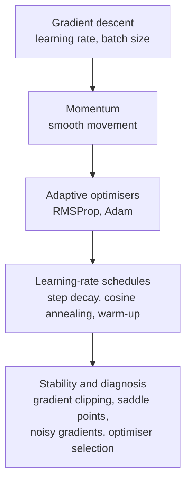

[Artificial Neural Networks](../../index.md) → Week 6: Optimisation Algorithms → Lesson 1: Introduction to Optimisation Algorithms

---

# Introduction to Optimisation Algorithms

## Key Concepts

### Where we are
- Forward pass → predictions. Backpropagation → **gradients**.
- ★ But gradients alone don't tell the network how to adjust its parameters. That is the
  job of **optimisation**: backpropagation gives the gradients, optimisation says **how to
  use them**.

### What optimisation decides
- How **fast** the network learns and how **big** the updates are.
- Which **direction** to move in.
- Whether training **converges**, and how to avoid bad regions.
- A poorly chosen optimiser can make learning extremely slow, diverge, or get stuck on
  plateaus. Good optimisation → faster convergence and better performance.

### What this week covers

- Goal: a toolkit to make deep learning models converge **faster, more smoothly and more
  reliably**.
- Every modern breakthrough in neural-network training relies on strong optimisation
  techniques, so we study it from the basics.
