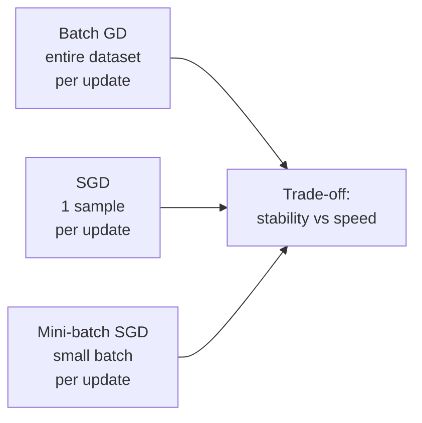
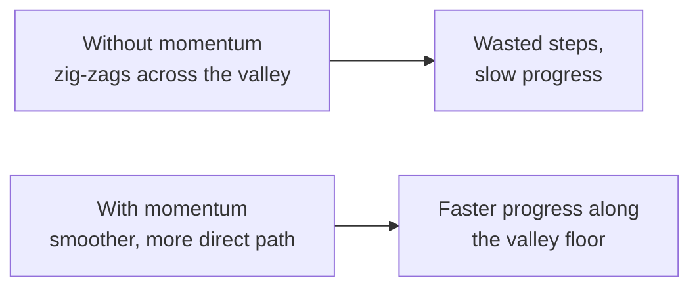

[Artificial Neural Networks](../../index.md) → Week 6: Optimisation Algorithms → Lesson 2: Gradient Descent and Momentum

---

# Gradient Descent and Momentum

## Key Concepts

### 1. What is Optimisation?

#### The goal of training
- Training aims to **minimise the loss**. Optimisation = finding the **weights and biases**
  that make the loss as small as possible. The optimiser explores combinations of
  parameters, trying to move the model into a region where it performs well.

#### The loss landscape
- With thousands or millions of parameters, the loss is a **high-dimensional surface**
  with valleys, hills, plateaus, ridges and **saddle points**.
- There can be several **local minima** and one **global minimum**; near a saddle point
  the surface is almost flat.
- ★ Optimisation finds a **good enough valley** and navigates the landscape efficiently,
  avoiding the regions that slow learning.
- Why it's hard: the surface is high-dimensional, gradients can be noisy or inconsistent,
  some regions are nearly flat and others very steep, and a poor learning rate can make
  training slow or unstable.

#### What the optimiser controls
| Aspect | Tool |
|---|---|
| Step size | **Learning rate** |
| Directional smoothing | **Momentum** |
| Per-parameter adjustment | **Adaptive optimisers** (RMSProp, Adam) |
| Stability | **Gradient clipping**, normalisation |

- ★ Together these decide convergence speed, final accuracy and training stability.
  Optimisation is more than computing the gradients.

---

### 2. Gradient Descent

#### Intuition
- Imagine standing on a curved landscape defined by the loss, with the parameter as a
  ball. Gradient descent: **look at the slope and step downhill**.
    - Slope negative (loss rises to the left) → move **right**.
    - Slope positive (loss rises to the right) → move **left**.
    - Slope ≈ flat → near a minimum.
- The gradient points in the direction the loss grows **fastest** (uphill), so the
  optimiser moves in the **opposite** direction.

#### Update rule
`θ_new = θ_old − η · ∇L`

- `θ` = the weight being updated, `η` = **learning rate**, `∇L` = gradient (the slope at
  the current point).
- The gradient gives the **direction**; the learning rate controls **how big a step**. Every
  parameter follows the same rule.

#### Learning rate
| Learning rate | Effect |
|---|---|
| Too small | Tiny steps, training extremely slow |
| Too large | Overshoots the minimum or **diverges** (loss increases) |
| Well chosen | Smooth, efficient progress downhill |

- Real networks have millions of dimensions: the gradient is a **vector** with a slope for
  every weight and bias, but the logic is unchanged: take a step that reduces the loss
  the most.

#### Worked check: `L(θ) = (θ − 3)²`
- Gradient `∇L = 2(θ − 3)`, start at `θ = 0`.

| Step | `η = 0.1` | `η = 1.1` |
|---|---|---|
| Start | θ = 0, gradient −6 | θ = 0, gradient −6 |
| After 1 update | θ = 0.6 (gradient −4.8) | θ = 6.6 (gradient +7.2) |
| After 2 updates | θ = 1.08 (steadily approaching 3) | θ = −1.32 (overshooting more each time) |

- `η = 0.1` creeps toward the minimum at 3; `η = 1.1` jumps past it and the distance from 3
  keeps growing (3 → 3.6 → 4.3 → …): divergence.

#### Practical points from the live class
- **Where this sits:** backpropagation gives the gradient of the loss for every weight and
  bias; **optimisation is the step that uses those gradients to update them**. Then the
  next batch uses the new weights, the loss and gradients are recomputed, and the loop
  repeats.
- **The loss is one number, the gradients are per parameter.** The loss is computed once
  for the whole batch; each parameter then gets its own partial derivative (its share of
  the blame), e.g. `W1 ← W1 − η · ∂E/∂W1`, `W2 ← W2 − η · ∂E/∂W2`. It is a **joint
  optimisation**: all parameters are updated together and do not counter each other.
- **Only the sign matters for direction:** positive gradient → decrease the parameter,
  negative gradient → increase it. The actual weight value can be anything (−2, +10).
- **`η` is a scaling factor** on the gradient (typical values 0.1, 0.01, 10⁻³), not a
  "rate" in the physics sense; it is the size of the change in `θ` per update.
- **Reaching a minimum:** the slope is ≈ 0, so `θ_new ≈ θ_old` and updates stall. It is
  normal to explore a little uphill to check it is a real minimum. You often end in a
  **good local minimum**, and that is fine; you never see the true loss curve, only the
  path your training traces.
- **When to stop (in practice):** real loss surfaces are not smooth, and some weights may
  want to move in opposite directions near the end. Teams stop when the loss stops
  improving or when business metrics (precision, recall, ...) are good enough.
- **One data point is enough for a gradient:** the loss has a fixed functional form (e.g.
  `(y − ŷ)²` or `−log ŷ`), so you can differentiate it for a single sample. That is why
  SGD (batch of 1) works.

---

### 3. Variants of Gradient Descent

#### Why variants exist
- With millions of samples, computing one gradient over the **whole dataset** is slow,
  expensive, memory-heavy and hard to scale. The variants differ only in **how much data
  each update uses**.

| | Batch GD | Stochastic GD (SGD) | Mini-batch GD |
|---|---|---|---|
| Data per update | Entire dataset | One sample | Small batch (typically **32–512**) |
| Update quality | Stable, smooth, correct direction | **Very noisy**, loss bounces around | Stable enough, with useful noise |
| Speed / cost | Very slow, memory-heavy, poor GPU use | Very fast per update | Fast; uses GPU parallelism well |
| Typical use | Small datasets or convex problems | Online / streaming data; rarely used alone | **Default** for neural networks |

- Noise from SGD isn't always bad: it can help escape **saddle points** or **sharp
  minima**.

#### Batch size matters
| Batch size | Behaviour |
|---|---|
| Small (16, 32) | Noisier gradients; can improve generalisation and escape bad regions |
| Large (1024+) | Very smooth gradients, but may converge to **sharp minima** and need learning-rate tuning or **warm-up** |
| 32–256 | Works extremely well for most tasks |

- ★ Batch size is one of the most important hyperparameters. Noise is sometimes exactly
  what the optimiser needs to keep moving.

#### Practical points from the live class
- **Naming is confusing:** "batch gradient descent" means the **entire dataset** per
  update. "Mini-batch" means whatever batch size you train with (e.g. 32). When code or
  slides say **SGD**, it almost always means **mini-batch gradient descent**.
- Mini-batches are formed by **random sampling**, so re-training can give a slightly
  different loss curve (e.g. 45 vs 60 epochs to converge). Well-represented batches give
  smoother curves.
- Batch GD is the ideal but impractical for large data; pure SGD (1 sample) suits
  **online / real-time learning** but gives a very wavy loss.

---

### 4. Momentum

#### The problem: zig-zag
- In a **narrow valley** (steep in one direction, shallow in the one we want), the
  gradient keeps pointing left and right across the walls. The optimiser wastes time
  correcting direction and converges slowly.

#### The idea: velocity
- Momentum keeps a **running average of past gradients**, like a ball rolling downhill:
  it keeps going through a gentle patch because it has accumulated speed.
    - Gradients consistently in one direction → the update **builds speed**.
    - Gradients oscillate → momentum **smooths** them out.
    - Gradients very small → momentum **carries** the update forward.

#### Update rule
- `v_t = β · v_{t−1} + (1 − β) · ∇L`
- `θ_t = θ_{t−1} − η · v_t`
- `β` = how much of the previous velocity to keep; typical **β = 0.9** (keep 90% of the
  previous direction). Conceptually: a weighted average of recent gradients.

#### Benefits
- Accelerates convergence, especially in **long, narrow valleys**.
- Reduces oscillation in steep dimensions.
- Helps escape shallow local minima; gives more stable training.
- Most useful with **noisy mini-batch gradients**, slow training, or narrow valleys.
- A standard addition to SGD; **Adam includes a version of momentum** internally.

#### Practical points from the live class
- **Reading `β`:** `β = 0.9` gives **90% weight to history** and 10% to the current
  gradient; `1 − β` is the weight on the current gradient. `β` lies between 0 and 1.
- **Momentum carries across batches:** `v_{t−1}` for the next batch is the `v_t` from the
  previous batch, so the velocity keeps accumulating through training.
- In the update, the **velocity replaces the raw gradient** (`θ ← θ − η · v_t`).
- Momentum helps most in deep valleys and strongly curved regions, and on flat patches.
- **All** gradient descent variants share one **global** learning rate `η` for every
  parameter; that is the limitation adaptive optimisers address (next lesson).
