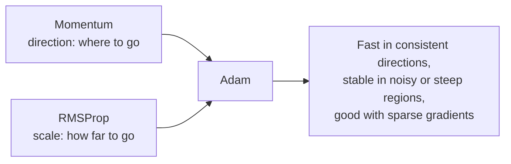
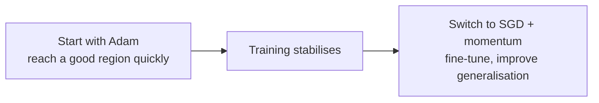

[Artificial Neural Networks](../../index.md) → Week 6: Optimisation Algorithms → Lesson 3: Adaptive Optimisers

---

# Adaptive Optimisers

## Key Concepts

### 1. Why Adaptive Methods Were Needed

#### Limits of SGD and momentum
- SGD uses **one global learning rate for every parameter**, but parameters behave very
  differently: some are sensitive and need tiny steps, others barely affect the loss and
  need large ones. A shared rate makes some learn too slowly and others unstable. The
  mismatch grows as networks get deeper.

| Situation | Problem with a single learning rate |
|---|---|
| **Sparse features** (NLP, recommenders, sparse inputs) | Many features are 0 most of the time, so their weights get **rare gradients** and hardly move |
| **Varying gradient size across layers** | Large-gradient parameters **overshoot**; small-gradient ones barely move |
| **Noisy mini-batch gradients** | The noise adds to the mismatch |
| **Plateaus and saddle points** | Large rate → divergence; small rate → very slow, even with momentum |

- What is needed: step sizes that depend on **each parameter's own gradient history**.

#### The adaptive idea
- Adaptive optimisers compute a **per-parameter learning rate** from the history of the
  gradients:
    - **noisy** parameters → dampened updates
    - **sparse** parameters → boosted updates
    - **stable** directions → accelerated updates
- Each parameter learns at the speed appropriate to it.

---

### 2. RMSProp

#### Idea
- Track how large each parameter's gradients have been **recently**. Consistently large
  gradients → **reduce** its step size; small gradients → **increase** its effective step
  size. Each parameter gets its own dynamically adjusted step.

#### Update rule
- Running average of squared gradients:
  `E[g²]_t = β · E[g²]_{t−1} + (1 − β) · g_t²`
- Parameter update:
  `θ_t = θ_{t−1} − η · g_t / √(E[g²]_t + ε)`
- The key part is the **denominator**: large recent gradients → large denominator → small
  update; small gradients → small denominator → larger update.

#### Intuition with numbers
- Two weights with steady gradients of 100 and 0.01, `η = 0.001`:
    - **Plain SGD:** steps of `0.001 × 100 = 0.1` and `0.001 × 0.01 = 0.00001`: wildly
      unequal.
    - **RMSProp:** each gradient is divided by roughly its own typical size, so both steps
      are about `η = 0.001`: balanced learning.

#### Benefits and defaults
- Reduces oscillation in steep directions, handles noisy mini-batch gradients, lets
  sparse-gradient parameters learn faster, and adjusts the rate continuously. Popular for
  **RNNs** and early deep models with unstable gradients.
- Typical defaults: **β = 0.9, η = 0.001, ε = 10⁻⁸** (ε avoids division by zero); little
  tuning needed.
- Limitation: **no momentum** on the gradients, so it can still be slow in directions
  where the gradient is consistent but small. This led to Adam.

---

### 3. Adam: Momentum + RMSProp

#### Idea

- Adam keeps two running statistics **per parameter**:
    - **First moment**: moving average of gradients (the momentum part: direction).
    - **Second moment**: moving average of **squared** gradients (the RMSProp part: step
      size).
- So it knows **where to go and how far**, separately for each parameter.
- Because both averages start at 0, Adam applies **bias correction** early in training to
  avoid underestimating them.
- Standard form (the video describes it only in words; no need to memorise):
  `m_t = β₁m_{t−1} + (1 − β₁)g`, `v_t = β₂v_{t−1} + (1 − β₂)g²`,
  `m̂ = m_t / (1 − β₁ᵗ)`, `v̂ = v_t / (1 − β₂ᵗ)`, `θ ← θ − η · m̂ / (√v̂ + ε)`.

#### Why it is popular
- Handles noisy mini-batch gradients and sparse gradients, needs minimal tuning,
  converges quickly, and works across many architectures, so it is often the default.

#### Weaknesses
- Can converge to **sharp minima**, which may **generalise worse** than solutions found by
  SGD.
- Can hide poor learning-rate choices and make debugging harder.
- Many practitioners switch from Adam to SGD for the final training stage.

---

### 4. When (and When Not) to Use Adam

#### Strong choice when
- Starting a **new project or architecture**: usually a safe first choice.
- Training is difficult or unstable: **deep or complex architectures**, **sparse
  gradients**, **noisy** large-scale mini-batch training.
- **Early experimentation**: fast feedback, little tuning. Widely used in NLP, vision and
  transformers.

#### Less ideal when
- **Final generalisation** matters most, e.g. **fine-tuning pre-trained models** or
  well-conditioned problems: **SGD with momentum** often wins on final accuracy.

| | Adam | SGD with momentum |
|---|---|---|
| Convergence | Fast, easy to use | Slower, needs more tuning |
| Generalisation | May sacrifice some | Often better final performance |

- Neither is universally better; the choice depends on your goals.

- ★ Switching optimisers mid-training is a common and effective practice.
- Common mistakes: using Adam blindly for every task, never adjusting the learning rate,
  using Adam for final fine-tuning without evaluation, assuming Adam always beats other
  optimisers. Optimisers are **tools, not magic**.

#### Practical points from the live class
- **RMSProp in words:** each parameter gets its own effective step `η / √(running average
  of its squared gradients)`. Recently large gradients → smaller step; recently small
  gradients → larger step. So the learning rate changes **per iteration and per
  parameter**, and parameters with weak gradients still learn.
- **Adam in words:** momentum (smoothed gradient, used in the numerator) + RMSProp
  (squared-gradient average, used in the denominator). Same update target `θ`, but the
  size of each adjustment is personalised using both.
- **Adam is the default** for experimentation and for checking that training works, but it
  can converge to a **sharp minimum**: a narrow dip where a small change in the weights
  changes the loss drastically. Such minima are unstable and tend to generalise worse.
  Check for one by nudging `W` slightly and seeing whether the loss jumps.
- **Standard recipe:** Adam for fast early progress, then switch to **mini-batch SGD +
  momentum** for final fine-tuning. The switch is by training stage (e.g. first few
  hundred or thousand batches with Adam, the rest with SGD + momentum); you can also mix
  and repeat batches.
- Switching to SGD with a small rate does **not guarantee** escape from a sharp minimum;
  changing the learning rate (even briefly raising it, e.g. 10⁻³ → 10⁻¹) can kick the
  weights out.
