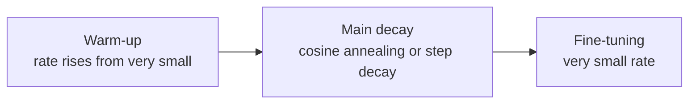
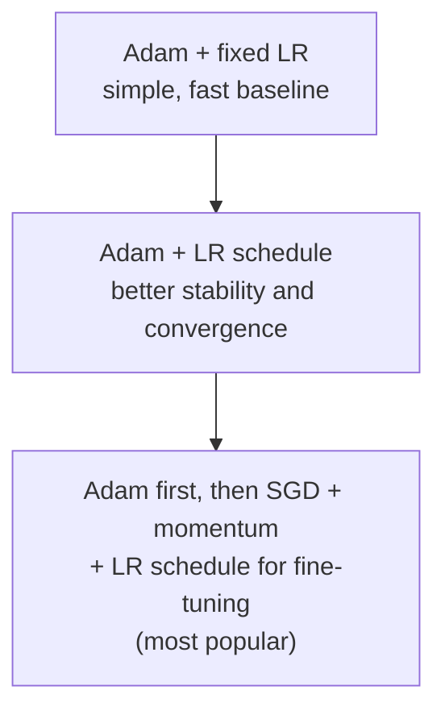

[Artificial Neural Networks](../../index.md) → Week 6: Optimisation Algorithms → Lesson 4: Learning Rate Scheduling

---

# Learning Rate Scheduling

## Key Concepts

### 1. Why a Fixed Learning Rate Is Limiting

#### What the learning rate does
- It sets how big a step the optimiser takes at every update: how fast the model learns,
  how stable training is, and whether it converges at all.
- A fixed rate assumes the **same step size suits every stage** of training. It rarely does.

#### Training has phases
| Phase | Situation | Best step size |
|---|---|---|
| **Early** | Far from the optimum; gradients large | **Large** steps → rapid progress |
| **Late** | Near a minimum; gradients small | **Small** steps; large ones cause oscillation or prevent convergence |

#### Failure modes
| Learning rate | What happens |
|---|---|
| Too large | Overshoots the minimum and bounces back and forth; loss oscillates or rises; may diverge. The loss curve refuses to go down smoothly |
| Too small | Painfully slow; tiny progress; struggles on flat regions; wastes computation (stable but impractical for large models) |

- A fixed rate forces a bad compromise: **large** → fast start, poor finish; **small** →
  stable but extremely slow.
- ★ Fix: **learning-rate scheduling** — change the rate over time to match the phase: fast
  initial learning, smoother convergence later, better final performance.

---

### 2. Popular Learning Rate Schedules

- A **schedule** defines how the learning rate changes as training progresses: start
  relatively large, then gradually reduce.

| Schedule | How it works | Pros / cons |
|---|---|---|
| **Step decay** | Constant for a while, then drops sharply at set points, e.g. 0.1 for the first 30 epochs → 0.01 → 0.001 | Simple, works well for many CNN models; you must choose *when* and *how much* to decay |
| **Exponential decay** | Multiply the rate by a fixed factor each step or epoch | Smooth and predictable; if too aggressive, the rate gets too small too early |
| **Cosine annealing** | Follows a cosine curve: starts high, falls smoothly, very small near the end | Smooth transitions; popular for large models; often used with **warm restarts** |
| **Warm-up** | Start with a **very small** rate and **increase** it over a few steps/epochs, then switch to a decay schedule | Prevents unstable early updates; important for **large batch sizes** and **transformers** |

- In practice schedules are rarely used alone. The common pattern: **short warm-up + main
  decay** → stability at the start, fast progress in the middle, precise fine-tuning at
  the end.

#### Which schedule?
- There is no single best schedule; it depends on the model, data and setup.
    - **Step decay** — simple, works well for many CNN-based models.
    - **Exponential decay** — when smooth reductions are wanted.
    - **Cosine annealing** — popular in modern, large-scale deep learning.
    - **Warm-up** — almost mandatory for transformers and large-batch training.
- ★ Scheduling almost always improves training stability and convergence.

#### Practical points from the live class
- **Why decay:** early on the model is far from the optimum, so **large steps** explore the
  loss landscape quickly; near a minimum, large steps overshoot and oscillate around it, so
  you want **small, fine-grained steps**.
- **Where you set it:** the schedule is configured in code together with the optimiser
  (e.g. Adam with `η = 0.1` plus a schedule).
- **Step vs smooth schedules:** all of them start high and end low. Step decay has
  **sudden drops** at chosen epochs (you must decide when and by how much); exponential
  and cosine follow a **smooth mathematical curve**, which is usually more stable and less
  jerky. Cosine stays high for longer before falling, and empirically often does better.
  Exponential decay needs careful tuning of its factor `γ`, or it can shrink too fast.
- **Typical combined pattern:** warm-up → main decay (cosine or step) → fixed very small
  rate (10⁻³ to 10⁻⁴) near convergence. Warm-up is used when early training is unstable
  (NaNs), with large batch sizes, and in transformers.
- **What an "epoch" means here is flexible:** the schedule can step per full pass over the
  data, per batch, or per group of 10–20 batches; some setups treat every batch as an
  "epoch". There is no single right choice. For small datasets (thousands of rows) you can
  use the whole dataset per update, which is more stable.
- **Adam / RMSProp** are adaptive, so they normally use **fewer** schedules; schedules are
  mostly paired with gradient descent methods. Raising the rate can also help jump out of
  a sharp minimum.

---

### 3. Adaptive vs Scheduled Learning Rates

#### Two ways to control the step size
- **Adaptive**: the optimiser adjusts the step **per parameter** from the gradient history
  (RMSProp, Adam).
- **Scheduled**: you **explicitly** change the learning rate over time by a predefined
  plan (step decay, cosine annealing, warm-up).

| | Adaptive (Adam, RMSProp) | Scheduled |
|---|---|---|
| Strengths | Powerful early; handle noisy and sparse gradients; little tuning; converge quickly; robust to gradient scale differences across layers | Precise control of the step size over time; improves late-stage stability and final generalisation, especially with SGD + momentum |
| Limitations | Can reach **sharp minima** that generalise worse; less explicit control later in training | Manual design and tuning; not per parameter; sensitive to the initial rate; assumes training is already fairly stable |
| Best when | Training is **difficult, noisy or exploratory** | Training is **stable** and final performance matters |

#### Common combinations

- ★ Combining both ideas is common and effective; no universal best choice.
