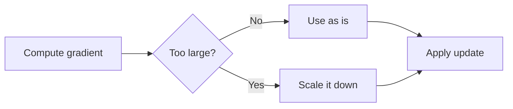
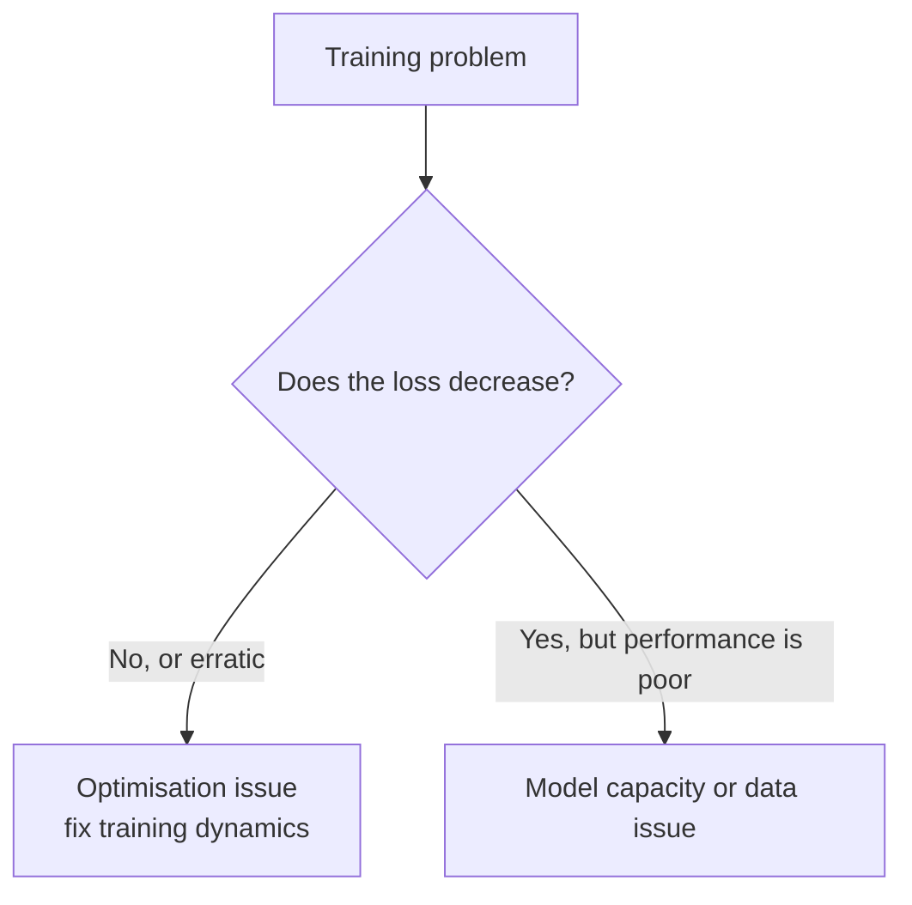

[Artificial Neural Networks](../../index.md) → Week 6: Optimisation Algorithms → Lesson 5: Stability and Convergence

---

# Stability and Convergence

## Key Concepts

### 1. Gradient Clipping

#### The problem
- Gradients can grow extremely large → huge parameter updates → loss spikes, unstable
  training, or a crash with `NaN`. Even one bad update can ruin an otherwise stable run.
- Common in **recurrent networks**, **very deep models**, and **early training** when
  parameters are poorly initialised.

#### The idea
- A **safety mechanism**: before applying an update, check the gradient size. Within a
  reasonable range → unchanged. Too large → **scale it down**. No single update can be
  catastrophically large.
- It limits update magnitude without changing the overall optimisation process.

#### Two types
| | Clipping by value | Clipping by norm |
|---|---|---|
| How | Limits each gradient **component** to a fixed range | Scales the **whole gradient vector** if its norm exceeds a threshold |
| Direction | Can **distort** the direction | **Preserves** the direction, limits the magnitude |
| Use | Simple | **More common** |

- Example (clip by norm, threshold 5): gradient `(30, 40)` has norm 50 → scaled by 5/50 to
  `(3, 4)`, which points the same way.

#### When to use it
- Training **recurrent models**, **very deep networks**, or using **large learning rates**;
  sudden **loss spikes** or exploding gradients early in training.
- Well-behaved models may not need it at all.

#### What it does *not* do
- Doesn't improve generalisation, doesn't fix **vanishing** gradients, and doesn't replace
  good learning-rate choices or initialisation.
- ★ A **safeguard, not a replacement** for good optimisation.

#### Practical points from the live class
- **`NaN` in the loss means training is broken:** stop and change something (architecture,
  initialisation, learning rate, clipping). It usually shows up in the **first 5–10
  epochs** if it is going to happen.
- **Why ReLU-family networks:** ReLU is **unbounded** for positive inputs, so exploding
  gradients are common in ReLU-based RNNs, LSTMs and transformers, which is where
  clipping is standard. Clipping gives you control over how far values may grow (unlike
  saturating activations, which cap them automatically and cause vanishing gradients).
- **Clipping by value:** any gradient above the threshold `τ` is set to `τ`. **By norm:**
  compute the magnitude of the **whole** gradient vector and, if it exceeds `τ`, scale
  all components down proportionally.
- **Update equation view:** `θ ← θ − η · ∇L`. Clipping controls the **gradient** term;
  learning-rate schedules control the **`η`** term. A large `η` or large gradients both
  call for clipping, so it is a balance.
- Clipping is one of several fixes (lower the learning rate, better initialisation,
  normalisation), not the only one.

#### Normalisation (recap from the live class)
- **Batch norm** normalises each feature using the mean and standard deviation **across
  the batch**; **layer norm** normalises across the **features of one sample**. Both keep
  activation magnitudes under control, which helps against exploding gradients.
- Batch norm is the usual default; **transformers** prefer layer norm because attention
  works per sample and parallelises across features. Batch norm is a poor fit for
  **time series** with seasonality that is not present in every batch.
- The four stabilisers: proper **initialisation** (Xavier / He), **better activations**
  (ReLU family), **gradient clipping**, **normalisation layers**.

---

### 2. Optimisation Pitfalls

- Training doesn't always explode: it often starts normally, then **slows, stalls or
  fluctuates**. These are frequently optimisation challenges, not code or data bugs.

| Pitfall | What it is | Effect |
|---|---|---|
| **Saddle points** | Gradient ≈ 0 but **not** a minimum (shaped like a horse saddle: up in one direction, down in another) | Far more common than local minima in high dimensions; the optimiser gets stuck or very slow, so it looks converged when it hasn't |
| **Plateaus** | Extremely flat regions; tiny gradients | Progress very slow; common in deep networks and with **saturating activations** |
| **Noisy updates** | Mini-batch randomness | Helps escape saddle points, but makes the loss fluctuate and harder to interpret |
| **Poor conditioning** | Very different curvature in different directions (some steep, some flat) | Zig-zag updates, slow progress, high sensitivity to learning rate. Helped by momentum, adaptive optimisers, normalisation |

#### Optimisation problem or modelling problem?

- Responses to optimisation issues: adjust the **learning rate**, **switch optimisers**,
  add **momentum** or **gradient clipping**, improve the **initialisation**. These target
  training dynamics, not the architecture.
- ★ Diagnosing these issues is an essential skill.

---

### 3. Convergence Behaviour: Noisy vs Smooth Descent

#### What convergence looks like
- Expect the loss to decrease and updates to get smaller, but it doesn't always look
  smooth.

| | Smooth convergence | Noisy convergence |
|---|---|---|
| Typical cause | **Large batches**, gradients averaged over many samples | **Mini-batches**, small batch sizes, relatively high learning rates |
| Loss curve | Steady, minimal fluctuation, easy to interpret | Goes up and down while the **overall trend is downward** |
| Downsides | Can be slower; may reach **sharper minima** that generalise worse | Harder to interpret |
| Upsides | Predictable | Helps escape **saddle points** and poor regions; encourages exploration; often finds **flatter minima**, which generalise better |

- ★ Noisy descent is normal and often beneficial; smooth descent is easier to read but not
  always better.

#### Batch size and optimiser effects
- **Small batches**: more noise and exploration, curves harder to read. **Large batches**:
  less noise, smoother curves, less exploration, possibly poorer generalisation. No single
  best batch size.
- **SGD with momentum**: tends to be noisier but often **generalises well**.
- **Adam / RMSProp**: usually smoother early training and faster convergence, but may
  settle into **sharper minima**.

#### How to read training curves
- Focus on the **long-term trend**: is the loss decreasing overall? Does the noise shrink
  over time? Does **validation** performance improve?
- Don't react to short-term fluctuations; they are a normal part of training.

#### Practical points from the live class
- **Saddle points are escaped by noise only if the step is big enough:** the gradient there
  is tiny, so a small learning rate or large batch will not jump out; a higher rate or
  smaller batch can. Momentum helps but may not be enough, so even Adam can get stuck.
  Stalled convergence can come from saddle points, plateaus, noise or poor conditioning.
- **Smoother curve = larger batch + smaller learning rate**, at the cost of slower
  convergence and a risk of settling in a **sharp minimum** that is hard to leave.
  Noisy descent (small batches, higher rate, diverse data) often **generalises better**.
- **Noise in the loss curve ≠ noisy data.** Diversity in the data adds to loss
  fluctuation, but don't clean it away: it may be real signal. With large datasets deep
  models cope; with small datasets be careful.
- **Fixes to try when convergence is poor:** adjust the learning rate or schedule first,
  then change the optimiser, add momentum or clipping, change the initialisation, raise
  the batch size.
- **Judging convergence:** look at the **loss curve first**, and only then dig into
  gradients per layer or parameter. The trend should go down, noise should shrink, and
  **training and validation loss should both fall**. If training loss falls while
  validation loss rises, that is **overfitting** (next topic: generalisation and
  regularisation).
- **Data splits:** training and validation are evaluated every epoch; the **test** set is
  a hold-out used once, after training. Debugging gradients in code is covered in modules
  10–12.
