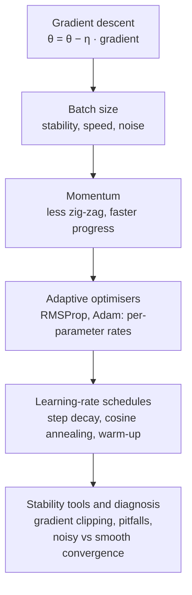

[Artificial Neural Networks](../../index.md) → Week 6: Optimisation Algorithms → Lesson 6: Module Summary

---

# Module Summary

## Key Concepts

### The big picture

### Key insights to carry forward
- Optimisation is **how networks learn by updating parameters**; it is more than applying
  gradients.
- Mini-batch SGD is the default; **batch size** affects stability, speed and noise.
- **Momentum** reduces zig-zag and speeds progress in consistent directions.
- **RMSProp and Adam** adjust learning rates automatically and work very well in early
  and noisy training.
- A **fixed learning rate is limiting**; schedules (step decay, cosine annealing,
  warm-up) match the step size to each phase of training.
- **Gradient clipping**, awareness of **pitfalls**, and reading **noisy vs smooth**
  convergence correctly keep training reliable.
- ★ Optimisation is about **training dynamics**: choose the optimiser, learning rate and
  schedule **together**. Stability tools **prevent failure**; they do **not guarantee
  success**.

### What's next — regularisation and generalisation
- Preventing **overfitting** and building models that perform well on **unseen data**.
- Techniques: **weight decay**, **dropout**, **early stopping**, **data augmentation**.
