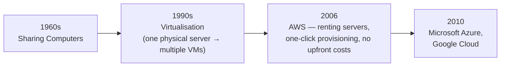
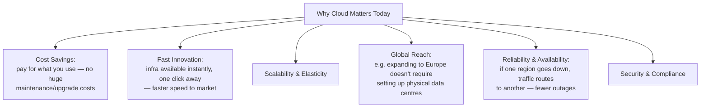

[Cloud Services and Platforms](../../index.md) → Week 1: Introduction to Cloud Computing → Lesson 1: Cloud Evolution & Fundamentals

---

# Cloud Evolution & Fundamentals

## Key Concepts

### 1. Cloud Evolution

---

### 2. Cloud & Key Traits

#### What is Cloud Computing
- Delivery of cloud services over the internet
- Pay for what you use — instead of physically maintaining servers, you rent them when you need them
- Increasing capacity is easy

#### Key Traits
- **Scalability** — expand as needed
- **Elasticity** — scale up or down based on usage
- **On-demand service**

---

### 3. Why Cloud Matters Today

