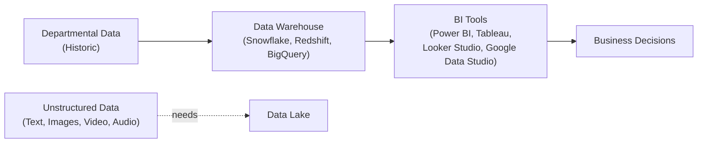
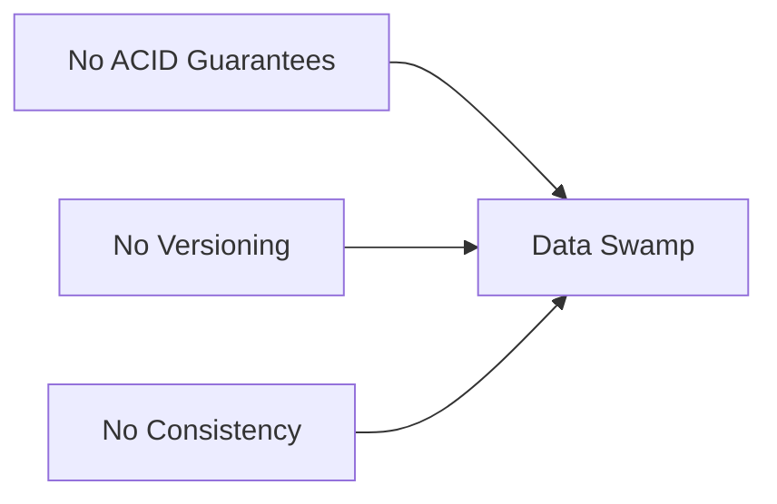

[Data Stores & Pipelines](../../index.md) → Week 1: Foundations of Data Storage Paradigms → Lesson 1: The Evolution of Data Storage

---

# The Evolution of Data Storage

## Key Concepts

### 1. From File Systems to RDBMS

#### Why We Store Data
- Operational records — e.g. transaction data
- Audit & legal requirements
- Machine learning for personalisation
- Historical analysis — trends over time

#### From Flat Files to RDBMS

| | Flat Files (CSV) | RDBMS |
|---|---|---|
| Structure | Plain rows in a file, no enforced structure | Data organised into tables |
| Querying | No standard query language | SQL |
| Data integrity | Not enforced | ACID properties, foreign keys, constraints |

- Examples: MySQL, PostgreSQL, Oracle, Microsoft SQL Server

#### Data Warehouses
- Come into the picture when you need to analyse historic data or very large volumes of data — something RDBMS (built for day-to-day transactional operations) isn't optimised for

---

### 2. Data Warehouse & BI

#### Data Warehouses — Consolidating Historic Data
- Bring together data from various departments, focused on historic data rather than day-to-day transactions
- Examples: Snowflake, Redshift, BigQuery

#### Business Intelligence (BI)
- A data visualization layer on top of the warehouse, used to make business decisions
- Examples: Power BI, Tableau, Looker Studio, Google Data Studio
- Fantastic for structured data

#### The Need for a Data Lake

- Data warehouses and BI tools are fantastic for structured data
- But organisations also generate unstructured data — unstructured text, images, videos, audio — which warehouses aren't built to hold
- This gap is what creates the need for a Data Lake

---

### 3. Data Lake to Lakehouse

#### Data Lake — A Central Repository
- A single central repository that stores all kinds of data: structured, semi-structured, and unstructured

| | Data Warehouse | Data Lake |
|---|---|---|
| Analogy | A library — well-organised | A massive digital hard drive |
| Organisation | Data is organised upfront | Stores data as-is, unorganised upfront |

| | Traditional Databases | Data Lakes |
|---|---|---|
| Step 1 | Define schema first | Store data as-is |
| Step 2 | Write data | Apply schema-on-read |

#### Problems with Data Lakes — the "Data Swamp"

- Without these guarantees, a data lake tends to degrade into a "data swamp" — data that's technically stored but too unreliable or disorganised to trust or use

#### From Data Swamp to Lakehouse

- Solving the data swamp problem — by adding ACID transactions, time travel, indexing/caching, and schema evolution on top of a data lake — is what leads to the Lakehouse architecture
- A Lakehouse blends the strengths of both: the Data Lake's ability to store all data types cheaply and at scale, with the Data Warehouse's reliability, structure, and query performance
