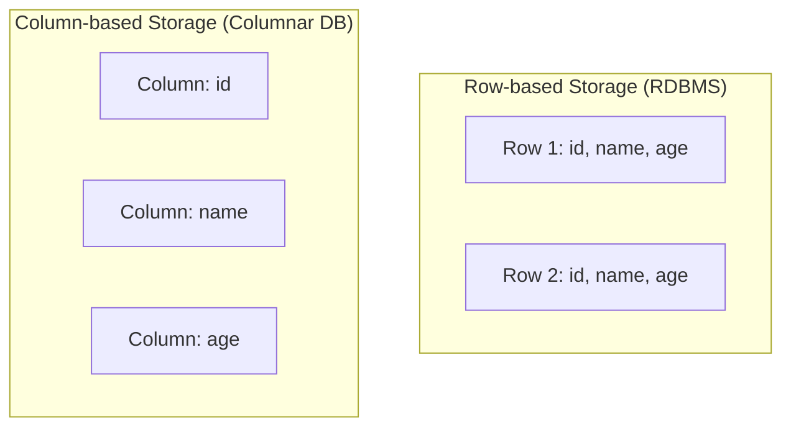

[Data Stores & Pipelines](../../index.md) → Week 1: Foundations of Data Storage Paradigms → Lesson 3: RDBMS vs Columnar Databases

---

# RDBMS vs Columnar Databases

## Key Concepts

### RDBMS

#### Key Features
- **Tables** — data is stored in tables with rows and columns
- **Relationships** — maintained across different data sets
- **SQL** — used for managing and querying the database

#### RDBMS Internal Data Storage
- Data is stored sequentially, row by row
- All column values are stored together within each row

### Columnar Database

#### What is a Columnar Database
- **Data storage method** — stores data by columns instead of rows
- **File structure** — each column is stored in a separate file or memory block
- **Optimisation** — optimised for read-heavy analytical workloads
- **Applications** — common in data warehousing and business intelligence

#### Row-based vs Column-based Storage

- Because each column is stored separately, a query only needs to scan the columns it actually needs, instead of reading whole rows — much faster for analytical queries that aggregate a few columns across many rows

### RDBMS vs Columnar — Use Case Matrix

| Use Case | Preferred DB Type | Reason | Examples |
|---|---|---|---|
| Banking/Financial Transactions | RDBMS | Requires strong ACID compliance, fast inserts/updates, real-time consistency | PostgreSQL, Oracle, MySQL |
| E-commerce Order System | RDBMS | Handles many real-time transactions (orders, payments, users) | Amazon uses Aurora |
| Healthcare Records | RDBMS | Patient data requires ACID transactions and privacy regulations | MS SQL Server, Oracle |
| Sales Dashboard (Monthly/Quarterly) | Columnar DB | Summarises huge volumes of historical data; fast aggregations across time, regions, products | Redshift, BigQuery |
| Customer Segmentation & Analytics | Columnar DB | Segmenting 10M+ customers based on age, region, behaviour — reads on a few columns across many rows | Snowflake, ClickHouse |
| Ride-sharing Data (e.g. Uber trip analysis) | Columnar DB | Trip history used for pricing models, regional insights, heatmaps | Uber uses Hadoop, Hive |
| Streaming Analytics (viewership, ad clicks) | Columnar DB | Analytics on millions of views: how long users watched, what was skipped | Netflix (Presto, Redshift) |
| Log Analysis/Application Monitoring | Columnar DB | Ingests logs from servers, enables time-series queries for DevOps | Apache Druid, Amazon Redshift |
| Business Intelligence Reports | Columnar DB | BI tools like Tableau or Power BI run queries for trends, KPIs | BigQuery, Snowflake |
