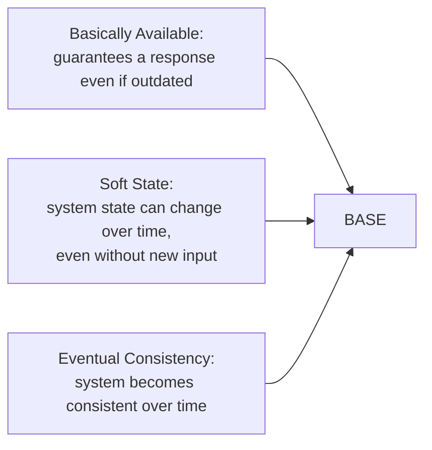
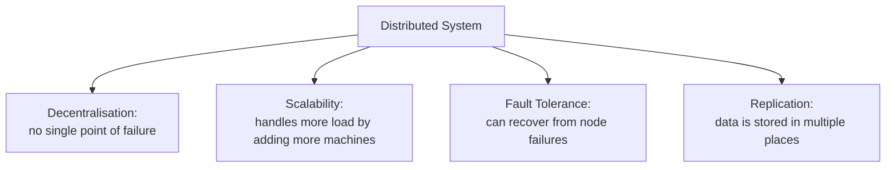

[Data Stores & Pipelines](../../index.md) → Week 1: Foundations of Data Storage Paradigms → Lesson 4: ACID vs BASE Models

---

# ACID vs BASE Models

## Key Concepts

### ACID Properties

#### Atomicity
- A transaction completes entirely, or not at all
- Example: a bank transfer from one account to another — either both the debit and credit happen, or neither does

#### Consistency
- The database moves between valid states, enforced through constraints like unique keys, foreign keys, and not-null rules

#### Isolation
- Each transaction executes as if it were running on its own, independent of other concurrent transactions
- Example: two people withdrawing from the same account at the same time shouldn't interfere with each other's transaction

#### Durability
- Once a transaction is committed, its changes are permanent — the system survives failures without losing it
- Example: an order confirmation, once given, still holds even if the system crashes right after

### BASE

- BASE prioritises scalability and speed — the trade-off distributed systems often make instead of strict ACID guarantees

### Distributed Systems

### CAP Theorem
- Introduced as three properties of a distributed system: **C**onsistency, **A**vailability, **P**artition tolerance
